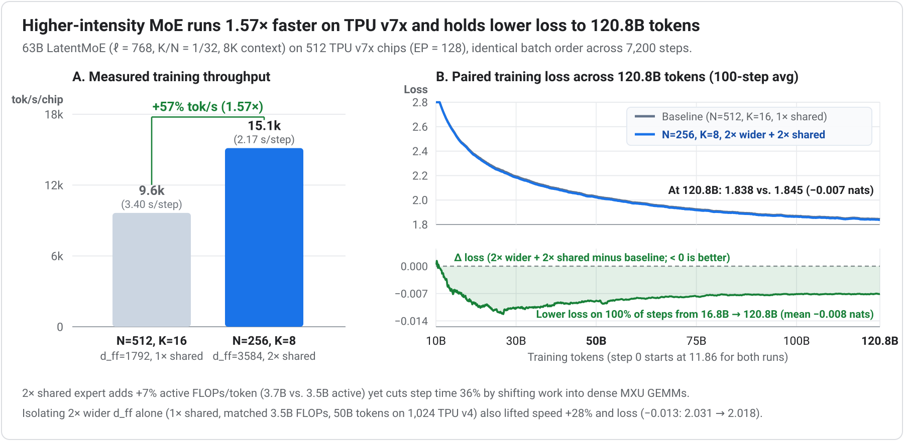
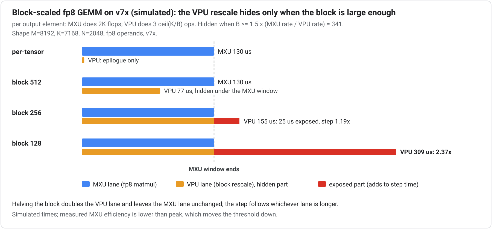

# Part II: Architecture Choices (Validate with Ablations)

Structural and numerical choices reshape an architecture's compute-to-memory and compute-to-communication ceilings. Because most affect expressive capacity or optimization dynamics, validate each choice with controlled wall-clock ablations on a tuned stack ([Appendix A.6](appendix-a.md#a6-measure-ablations-in-wall-clock-not-flops)).

---

## 4. Compress routed token traffic with LatentMoE

Standard expert parallelism (EP) dispatches every routed token across chips at full `d_model` width. In Ironwood benchmarks on uncompressed MoEs, that cross-chip traffic was heavy enough that plain FSDP outperformed EP + FSDP.

The structural fix is **LatentMoE**: project each token from `d_model` ($d$) down to a narrower latent width `ℓ` before dispatch, execute the routed experts entirely in `ℓ`-dimensional latent space, and project back up to `d_model` after combine. Every cross-chip collective and on-device token permute then moves `ℓ`-wide vectors rather than `d_model`-wide vectors. First introduced by [Nemotron 3](https://arxiv.org/abs/2512.20856), LatentMoE has been adopted at frontier scale by Microsoft's 962B [MAI-Base-1](https://microsoft.ai/pdf/mai-thinking-1.pdf) (34.7B active) and Moonshot AI's 2.8T [Kimi K3](https://arxiv.org/abs/2607.24653) ("Stable LatentMoE", 16-of-896 routed experts).

**Quantified design rules:**

* **Two regimes, two bottlenecks:** With expert intermediate width $m = d_{\text{ff}}$, small-batch latency-bound serving is dominated by streaming expert weights ($\propto d \times m$), while throughput-bound serving and training are dominated by all-to-all dispatch volume ($\propto K \times d$, independent of $m$). Model expressive capacity tracks the nonlinearity budget $K \times m$.
* **Compress by $d / \ell \approx 2\text{–}4\times$ and reinvest:** Compressing routed tokens from $d$ to $\ell$ cuts both bottlenecks by $d / \ell$. Reinvest the saved bandwidth into more total and active experts while keeping $K_{\text{new}} \times \ell \le K_{\text{old}} \times d_{\text{model}}$, raising the nonlinearity budget $K \times m$ at constant communication traffic. In Nemotron 3's ablation, LatentMoE ($\ell = 1024$, $N = 512$ experts, top-22) outperformed standard MoE ($d = 4096$, $N = 128$, top-6) across benchmarks at matched active and total parameters.
* **Route on full `d_model`:** Compute router gates on the full-width `d_model` representation before compressing; keep the router gate, shared expert, attention, and residual stream at full `d_model` ([MAI-Base-1](https://microsoft.ai/pdf/mai-thinking-1.pdf) follows this exact split).
* **TPU specifics:** Keep `ℓ` (and `ℓ / TP` if sharded) a multiple of 256; quantize all-to-all dispatch payloads to FP8 (halving cross-chip bytes a second time at near-zero quality cost); keep the lightweight latent down/up projections in BF16 (a negligible share of step time); and place the EP group along one short physical axis of the 3D ICI torus.

**Measured** (30B-class MoE benchmark on Ironwood): On a 30B / 128-expert MoE, an `ℓ = 768` ($2.67\times$ compression) LatentMoE variant cut on-device token permute time **2.8×**, lifted end-to-end training throughput by **+14% tokens/s** (322 vs. 270 TFLOP/s/chip, or +19% FLOP/s, since the shared latent projections add ~5% FLOPs per token), and freed **~25 GB/device** of activation HBM when rematerialization checkpoints were anchored on the compressed latent ([Appendix A.3](appendix-a.md#a3-remat-friendly-blocks)). Because tokens remain `ℓ`-wide past the down-projection, *all* dispatch data movement shrinks: on-device sort/gather/scatter permutes under FSDP as well as cross-chip all-to-all collectives under EP.

**Recommendations:**

* Tune `ℓ` against validation loss within the $2\text{–}4\times$ compression band while keeping `ℓ` a multiple of 256.
* Avoid over-fragmenting experts under both FSDP and EP: per-expert GEMM group size shrinks as $\text{tokens} \times K / N$, starving 256×256 MXU tiles under FSDP, while dispatch volume grows with $K$ under EP. Compress the token path first, then pair LatentMoE with a large shared expert and wider `d_ff` ([Principle 5](#5-raise-compute-intensity-with-a-large-shared-expert-and-wider-experts)) rather than scaling $N$ and $K$ indiscriminately.
* While current smaller MoE configs in [tpu-recipes](https://github.com/AI-Hypercomputer/tpu-recipes/tree/main/training) often run plain FSDP (or FSDP + TP), LatentMoE + FP8 dispatch makes EP roofline-viable at larger scale when per-device batch sizes shrink too far to hide FSDP weight all-gathers behind layer compute. Decide FSDP versus EP with a roofline calculation and confirm with a short profiled run.

---

## 5. Raise compute intensity with a large shared expert and wider experts

When candidate MoE layouts match on quality, pick the one with higher compute intensity at a comparable active-parameter budget. Shifting work into larger, denser MXU matmuls per dispatched byte improves both training MFU and serving efficiency through two complementary structural levers:

* **Include one large shared expert in every LatentMoE layer:** Shift a meaningful share of the per-token active parameter budget (wider `d_shared`) into a single large shared expert operating at full `d_model`. Shared-expert GEMMs are dense, communication-free, MXU-friendly, and FSDP-shardable, and can be scheduled to **overlap directly with EP all-to-all dispatch and combine**. At decode time, shared-expert weight reads amortize across every token in the batch regardless of routing skew. Shared-expert MoE across layers (sometimes preceded by 1–3 initial dense FFN stem layers to stabilize early routing, as in [DeepSeek-V3](https://arxiv.org/abs/2412.19437) and Kimi K2, or paired with Stable LatentMoE in [Kimi K3](https://arxiv.org/abs/2607.24653)) is the standard open-weight layout. Ablate the `routed : shared` split on TPU rather than copying GPU co-designed models, since the TPU optimum is more shared-heavy.
* **Trade excessive `(N, K)` fragmentation for wider expert `d_ff`:** Optimal `(N, K)` grows with total model scale, so avoid copying fixed small-expert counts across model sizes. At fixed sparsity ratio $K / N$ and constant active expert width $K \times d_{\text{ff}}$, halving $N$ and $K$ while doubling expert $d_{\text{ff}}$ cuts $K$-proportional dispatch traffic in half and doubles per-expert GEMM tile fill without increasing batched-decode weight reads ([Appendix B](appendix-b.md)). Because over-coarsening reduces routing diversity, ablate granularity alongside the shared-to-routed split at your target scale.

**Measured (512 TPU v7x chips, 120.8B tokens):** On a 63B LatentMoE (`ℓ = 768`, $K/N = 1/32$, 8K context, 512 TPU v7x chips at EP = 128, identical batch order across 7,200 steps), halving $(N, K)$ from $(512, 16)$ to $(256, 8)$ while doubling routed `d_ff` ($1792 \to 3584$) and doubling the shared expert ($1\times \to 2\times$, `3.7B` vs. `3.5B` active parameters) lifted end-to-end training throughput by **+57% tok/s (1.57×)** and held lower training loss across the entire 120.8B-token run (`1.838` vs. `1.845` nats at 120.8B):

**Measured single-factor check (isolating wider `d_ff` alone on 1,024 TPU v4 chips):** Holding the shared expert fixed ($1\times$, matched 3.5B active parameters and FLOPs at EP = 128) while halving $(N, K)$ and doubling `d_ff` alone also improved both step throughput and windowed training loss:

| Configuration ($K / N = 1/32$, $1\times$ shared) | 15B-token training loss | 50B-token training loss | Step time (MFU) | Throughput gain |
| :--- | ---: | ---: | ---: | ---: |
| `N = 512, K = 16, d_ff = 1792` | 2.418 | 2.031 | 2.78 s (22.4%) | baseline |
| `N = 256, K = 8, d_ff = 3584` (2× wider) | **2.395 (-0.023)** | **2.018 (-0.013)** | **2.17 s (28.5%)** | **+28% tok/s** |

---

## 6. Low-precision as architecture, not afterthought

Low-precision training is mixed-precision training: quantize the large GEMMs while keeping a compact set of numerically sensitive operations in BF16 or FP32. A reliable starting high-precision set includes **every softmax input** (attention logits, router logits, output logits), **router gating**, **normalization layers**, **embeddings**, and **the final transformer layers**. Beyond that baseline, monitor training loss stability and promote additional ops only when the loss curve diverges or degrades.

**Bake dynamic-range bounding into the architecture:** Attention-logit bounding (`QK-norm`, or weight-space `QK-clip`) and output-logit control (`z-loss` or logit soft-caps) bound activation outliers by construction, enabling cheap static or coarse block scaling to preserve full BF16 quality. Architectural range bounding matters even more on TPU v7x than on GPUs whose fine-grained hardware micro-scaling can mask unbounded activation spikes.

**Sub-channel (block-scaled) quantization on Ironwood (TPU v7x) and earlier (use block size ≥ 512):** Because the v7x MXU does not apply sub-channel block scales inside the systolic array, per-block rescaling executes on the VPU. As derived in [Principle 9](#9-minimize-exposed-vpu-time), v7x's ~240:1 FP8-MXU to FP32-VPU peak throughput ratio sets the theoretical VPU-hiding threshold at $B \ge 1.5 \times r_{\text{MXU}} / r_{\text{VPU}} \approx 360$ elements; finer blocks expose VPU rescales outside the MXU window. Use FP8 block sizes of **512 or larger** on v7x (while benchmarking candidate block sizes on your actual GEMM shapes) and rely on `QK-norm` and `z-loss` to hold quality. The [Qwen3.5-397B on Ironwood optimization playbook](https://developers.googleblog.com/systems-engineering-playbook-optimizing-qwen-35-397b-moe-on-ironwood-tpu7x/) applied this exact change, switching to 512-element sub-channel FP8 scaling to eliminate VPU register spills and stalls.

**Where FP8 pays ([tpu-recipes](https://github.com/AI-Hypercomputer/tpu-recipes) on Ironwood):** Dense models gain ~1.5× step-time speedup from FP8, while unoptimized MoEs gain ~1.2× because routing and cross-chip communication dominate the MoE step and GEMM-only quantization leaves those costs untouched. Shrinking dispatch and non-matmul overhead first ([Principles 4](#4-compress-routed-token-traffic-with-latentmoe), [9](#9-minimize-exposed-vpu-time), and [10](systems-mapping.md#10-map-model-axes-onto-the-physical-mesh)) raises the matmul share of the step so low-precision speedups compound.

**Lower MoE expert precision first, and quantize further for serving:** Routed expert GEMMs hold the vast majority of model weights, sit behind a high-precision router gate, and tolerate lower precision than attention projections. That makes 4-bit expert compute attractive on supported training hardware ([Nemotron 3](https://arxiv.org/abs/2512.20856)'s NVFP4 pretraining recipe is a prominent precedent; on v7x, validate the kernel's actual arithmetic format and conversion overhead rather than assuming native FP4 MXU throughput) and standard at serving time (Kimi K2 Thinking serves quantization-aware-trained INT4 routed experts while keeping attention and shared paths in higher precision). See [Appendix A.7](appendix-a.md#a7-quantize-further-for-serving) for post-training quantization (PTQ) guidelines.

---

## 7. Hybrid attention for long context: pick the TPU-mature variant

Full quadratic attention on every layer makes long-context prefill compute-heavy and long-context decode KV-bandwidth-bound. Frontier models have converged on three hybrid attention families that retain a small fraction of full global attention layers and make the remaining layers sub-quadratic:

* **Local/global sliding-window interleave:** Most layers use sliding-window local attention while 1 in $N$ stays global (for example, 5:1 in [Gemma 3](https://arxiv.org/abs/2503.19786) with a 1,024-token local window on 4B–27B and 512 on 270M/1B using Dual-RoPE, and 5:1 in [MAI-Base-1](https://microsoft.ai/pdf/mai-thinking-1.pdf) with a 512-token window and NoPE on global layers to aid length extrapolation).
* **Linear-attention / recurrent hybrids:** Most layers use a constant-state recurrence with $O(1)$ per-token decode state and no RoPE extrapolation ceiling, including Mamba-2 ([Nemotron 3](https://arxiv.org/abs/2512.20856)), Gated DeltaNet ([Yang et al., 2025](https://arxiv.org/abs/2412.06464); [Qwen3-Next](https://huggingface.co/Qwen/Qwen3-Next-80B-A3B-Thinking)), and Kimi Delta Attention ([Kimi K3](https://arxiv.org/abs/2607.24653) at 1M context).
* **Compressed or sparse KV attention:** Retain attention across layers while shrinking KV traffic via latent KV compression ([DeepSeek-V3](https://arxiv.org/abs/2412.19437) MLA) and learned sparse token selection (DeepSeek-V3.2).

**TPU guidance:** **Local/global sliding-window interleave is the lowest-risk drop-in default**: block-aligned sliding windows map directly onto `SplashAttention` with VMEM-friendly tiles (choose window sizes that are multiples of the Splash kernel block size). Chunkwise linear-attention hybrids (`Gated DeltaNet`, `KDA`, `Mamba-2` in Pallas and open-source [Tokamax](https://github.com/openxla/tokamax)) provide the largest long-context KV memory cut by replacing growing KV caches with fixed-size state; align state head dimensions to `head_dim = 256` ([Principle 1](shape-rules.md#1-align-every-per-device-reduction-and-output-dimension-to-256)) and tune chunk sizes to VMEM so chunk matmuls stay MXU-bound rather than VPU-bound.

**KV-cache sizing and kernel roofline verification:** Hybrid mixers pay twice at decode because HBM capacity caps batch concurrency while KV reads consume HBM bandwidth ([Principle 12](systems-mapping.md#12-co-design-for-prefilldecode-disaggregation-and-align-with-the-tpu-serving-stack)). Windowed layers cap per-layer KV at the window length, linear-attention layers hold state size constant in sequence length, and MLA shrinks each token's KV entry. Always size total KV/state memory at `target batch × target context` before choosing a family. Finally, remember that **paper FLOP reductions require a kernel that realizes them**: reducing attention FLOPs while still streaming $Q$, $K$, and $V$ lowers arithmetic intensity, which can push an untuned windowed or linear-attention kernel into the memory- or VPU-bound regime while global `SplashAttention` runs near peak MXU roofline. Benchmark candidate mixers in wall-clock time at your target window, context, and `head_dim = 256` shape before locking in the architecture.

---

## 8. Overcome the decode bandwidth wall: low-diameter scale-out (8.1) and speculative decoding (8.2)

At low to moderate serving concurrency, autoregressive decode streams model weights every token (~300 concurrent tokens per weight shard are needed in dense FP8 to reach compute roofline; see [Appendix A.4](appendix-a.md#a4-size-the-model-to-your-real-serving-concurrency)). Combine two architectural levers with explicit concurrency sizing:

### 8.1. Scale out over high-connectivity, low-diameter topologies

Single-slice decode latency is bounded below by `per-chip weight bytes ÷ HBM bandwidth`. Spreading weights across more chips via TP and EP multiplies aggregate HBM bandwidth, provided multi-chip collective latency does not erase the gain. Scaling out across high-connectivity, low-network-diameter interconnects (such as [Boardfly on TPU 8i](https://cloud.google.com/blog/products/compute/tpu-8t-and-tpu-8i-technical-deep-dive)) aggregates HBM bandwidth across large chip pools while keeping hop count and collective latency low, outperforming single-chip bandwidth ratios in latency-sensitive regimes.

### 8.2. Speculative decoding as a design input (MTP heads or drafter)

A lightweight drafter proposes candidate future tokens and the target model verifies them in parallel in a single forward pass, amortizing each HBM weight read across multiple accepted tokens ([speculative decoding](https://arxiv.org/abs/2211.17192)).

**Multi-Token Prediction (MTP) heads are the cleanest design-time option:** Jointly trained MTP heads provide both a denser pretraining supervision signal and a built-in drafter without deploying a separate draft model. [DeepSeek-V3](https://arxiv.org/html/2412.19437v2#S5.SS4.SSS3) reports 85–90% acceptance on the first drafted token; [Qwen3-Next](https://huggingface.co/Qwen/Qwen3-Next-80B-A3B-Thinking) and [GLM-4.5](https://arxiv.org/html/2508.06471v1#S2) likewise include native MTP heads; and [Nemotron 3](https://research.nvidia.com/labs/nemotron/files/NVIDIA-Nemotron-3-White-Paper.pdf#page=5) reports ~2.4% average relative benchmark gains alongside ~97% acceptance across the first two drafted tokens in an 8B-active MoE ablation. Keep MTP heads in BF16.

**Measure net committed tokens/s and size to real concurrency:** Account for drafting, verification, and KV rollback overhead across the full cycle at target concurrency (gains taper naturally once batch concurrency makes decode compute-bound). Per-token decode latency is bounded below by `per-chip weight bytes ÷ HBM bandwidth` (for example, when the batch touches all experts, Qwen3.5-397B in FP8 across 4 Ironwood chips streams ~100 GB/chip, setting a ~13.5 ms weight-read floor before KV), while max batch is capped by `(remaining HBM) ÷ (allocated KV/state per sequence)`. For MoEs, weight traffic scales with the **union of experts touched across the batch** ($E \cdot [1 - (1 - K/E)^B]$ under uniform routing); profile busiest-rank skew and replicate hot experts ([DeepSeek-V3](https://arxiv.org/pdf/2412.19437)) when HBM permits. If real concurrency will be small, design fewer active bytes rather than planning around a batch size you will not have ([Appendix A.4](appendix-a.md#a4-size-the-model-to-your-real-serving-concurrency), [Appendix B](appendix-b.md)).

---

## 9. Minimize exposed VPU time

Norms, activations, masking, routing math, and quantization scale applications run on the Vector Processing Unit (VPU), which sits roughly two orders of magnitude below the MXU in peak throughput and executes sequentially with matmuls unless XLA fuses the work into an adjacent GEMM or offloads it off the TensorCore:

* **Remove what buys no model quality:** Eliminate redundant reshapes, transposes, layout format copies, and tiny per-token elementwise ops that force unamortized HBM round-trips.
* **Fuse what stays into adjacent GEMMs:** Standalone VPU kernels between GEMMs stall MXU overlap. Standardize on fusable `RMSNorm` and `SwiGLU` so XLA and Pallas fold elementwise operations into neighboring GEMM VMEM pipelines (just as fused attention kernels hide online softmax behind $QK^\top$ and $PV$ matmuls).
* **Offload irregular dispatch movement to SparseCore:** MoE token `sort`, `gather`, and `scatter` operations belong on SparseCore ([Principle 10](systems-mapping.md#10-map-model-axes-onto-the-physical-mesh)), running asynchronously alongside the TensorCore.

**Fused VPU work is free only while its cycle count fits inside the MXU window:** Block-scaled FP8 GEMM illustrates this hardware bound directly. With one scale factor per block of $B$ elements along the contraction axis $K$, the MXU emits one partial sum per output element per block ($2K$ MXU FLOPs per output element) and the VPU rescales and accumulates each partial sum (roughly $3 \cdot \lceil K / B \rceil$ vector ops per output element). The VPU rescale stays completely hidden under the MXU matmul when:

$$B \ge 1.5 \times \frac{r_{\text{MXU}}}{r_{\text{VPU}}}$$

On Ironwood (TPU v7x, with `4,614` TFLOPS FP8 MXU peak against `19.2` TFLOPS FP32 vector peak, a ratio near `240:1`), this peak-rate threshold lands near **$B \approx 360$**:

In simulation on a DeepSeek-V3 expert GEMM shape ($M = 8192, K = 7168, N = 2048$ with FP8 operands on v7x), `block 512` (`77 µs` VPU work hidden inside the `130 µs` MXU window) runs at the per-tensor time (`1.0×`), whereas `block 256` goes VPU-bound at **1.19×** (`155 µs`, `25 µs` exposed) and `block 128` slows to **2.37×** (`309 µs`). Because achieved MXU efficiency on real shapes sits below theoretical peak, the effective $r_{\text{MXU}} / r_{\text{VPU}}$ ratio is lower in practice and can make smaller block sizes workable; always benchmark your target GEMM across candidate block sizes rather than relying on peak ratios alone ([Principle 6](#6-low-precision-as-architecture-not-afterthought)).
