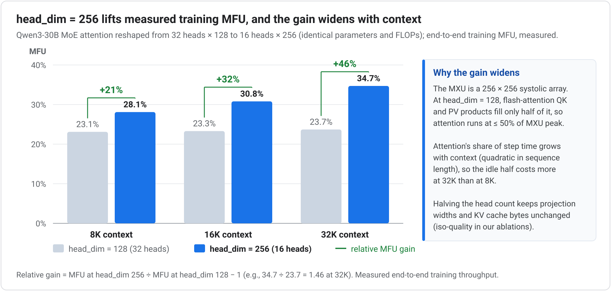
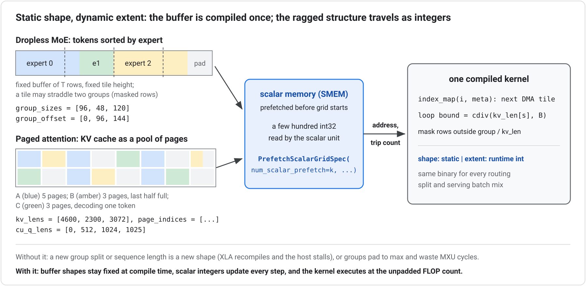
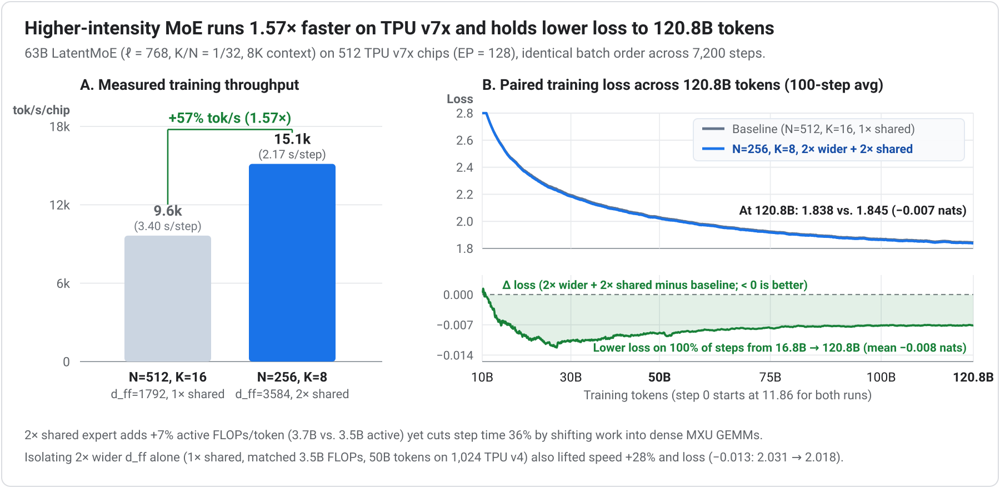
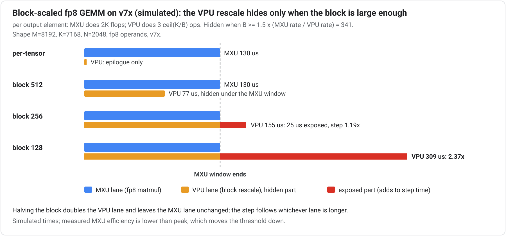
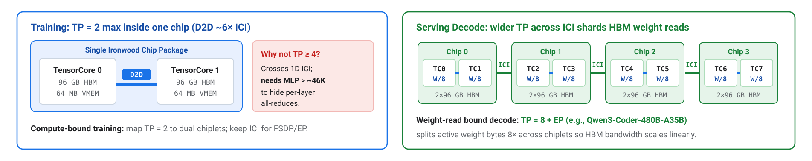
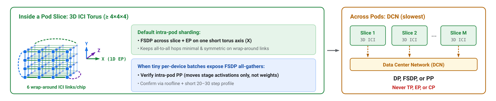
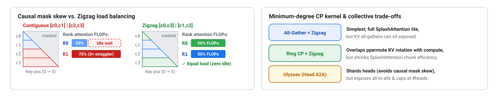
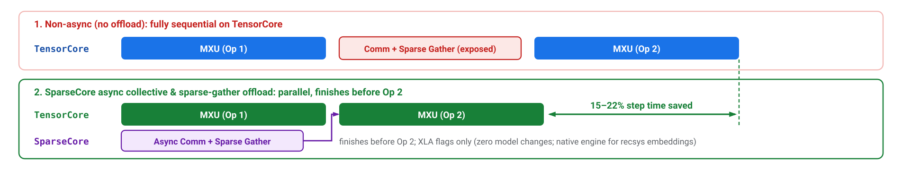

# TPU Model Design Considerations and Optimization Guide

**Authors:** Gagik Amirkhanyan and Vaibhav Singh (Google Cloud)

## Purpose

Google designed TPUs from the ground up for machine learning efficiency across both training and inference. Getting the most out of TPUs, or any other system, comes down to a set of architectural best practices that have co-evolved over a decade of performance engineering by TPU users inside and outside Google. We are making these practices openly available to the TPU community through this living guide. Large language models (LLMs) and Mixture-of-Experts (MoE) architectures receive the deepest coverage ([Principles 3–5](#3-static-shapes-everywhere-including-dropless-moe-routing), [Principle 9](#9-minimize-exposed-vpu-time)) because sparse routing and cross-chip dispatch benefit most from TPU-aware design, while the underlying principles apply to any computation you want to accelerate on TPUs (including multimodal and world models) and largely carry over to other accelerators as well.

Prefer multi-chapter navigation? Browse the [online book and blog](https://ai-hypercomputer.github.io/tpu-codesign/) or start at [`docs/index.md`](index.md).

## Co-designing models for Ironwood (TPU v7x) and future TPU generations: training and inference

Performance tuning starts with model definition. Architectural choices made before the first training step set permanent ceilings on Model FLOP Utilization (MFU), training cost, and serving latency. This guide provides concrete, hardware-grounded design rules for teams building or adapting models for TPUs, organized into three groups by engineering stage and quality risk:

1. **[Shape rules](#part-i-shape-rules-adopt-always) (Principles 1–3):** Hardware-aligned dimensions, single-plan parallelism, and static shapes with dynamic runtime extent; near-zero model-quality risk. *Adopt always.*
2. **[Architecture choices](#part-ii-architecture-choices-validate-with-ablations) (Principles 4–9):** Structural and numerical design choices; most involve quality trade-offs. *Validate with ablations.*
3. **[Expressing parallelism & systems mapping](#part-iii-expressing-parallelism-systems-mapping-no-model-changes-required) (Principles 10–13):** Parallelism placement across physical links, memory pipelining, serving disaggregation, and compiler tuning; no model checkpoint changes required.

**How to use this guide.** The shape rules apply to anyone designing a new model; use the summary table below to filter the rest, with the *Targets* column routing training versus inference owners and the *Scope* column marking the MoE-specific rules. If you are adapting an existing checkpoint rather than designing a new architecture, jump directly to [Systems mapping](#part-iii-expressing-parallelism-systems-mapping-no-model-changes-required) and [Blueprint & Diagnostics](#part-iv-where-to-start-diagnostics-and-100b-blueprint). The general rules hold for any matmul-dominated architecture, and this repository grows model- and workload-specific studies over time.

## Principles at a glance

| # | Group | Guideline summary | Scope | Targets | Quality risk |
| :--- | :--- | :--- | :--- | :--- | :--- |
| [1](#1-align-every-per-device-reduction-and-output-dimension-to-256) | Shape | Make every per-device model reduction and output dimension a multiple of 256 (most frequently missed: `head_dim = 256`); counts such as `num_heads`, `layers`, and `batch` are exempt. | General | Both | ~None |
| [2](#2-plan-one-parallelism-strategy-from-4-chips-to-multi-pod) | Shape | Plan dimensions for a large TPU scale-up domain (FSDP/TP/EP over ICI) paired with multi-slice scaling (DP/FSDP/PP over DCN, never EP or TP). | General | Training | ~None |
| [3](#3-static-shapes-everywhere-including-dropless-moe-routing) | Shape | Separate compile-time buffer shape from runtime data extent via bucketing, masking, and `SMEM` scalar prefetch (`PrefetchScalarGridSpec`) so dropless MoE (`Megablox`, Tokamax GMM) and paged attention run without recompilation or padding waste. | General + MoE | Both | ~None |
| [4](#4-compress-routed-token-traffic-with-latentmoe) | Arch | Compress routed token communication volumes with **LatentMoE** (reinvesting saved bandwidth into expert capacity) and low-precision (FP8) all-to-all dispatch. | MoE | Both | Ablate (LatentMoE); FP8 A2A is quality-neutral |
| [5](#5-raise-compute-intensity-with-a-large-shared-expert-and-wider-experts) | Arch | Prefer higher compute intensity when quality is neutral: pair every LatentMoE layer with one large shared expert (overlapping EP dispatch) and trade excessive `(N, K)` fragmentation for wider expert `d_ff`. | MoE | Both | Ablate |
| [6](#6-low-precision-as-architecture-not-afterthought) | Arch | Bound dynamic ranges (`QK-norm`, `z-loss`) for low precision. Sub-channel block scaling runs on the VPU on TPU v7x and earlier (~240:1 MXU:VPU ratio; use FP8 block size ≥ 512). | General | Both | Ablate |
| [7](#7-hybrid-attention-for-long-context-pick-the-tpu-mature-variant) | Arch | Adopt hybrid sub-quadratic attention for long context: 5:1 local/global sliding-window interleave as the low-risk default, or linear-attention / compressed-KV hybrids to cut prefill FLOPs and decode KV footprint. | General | Both | Ablate |
| [8.1](#81-scale-out-over-high-connectivity-low-diameter-topologies) | Arch | Overcome memory-bandwidth-bound decode at low latency by scaling out across high-connectivity, low-network-diameter topologies (such as Boardfly on TPU 8i). | General | Inference | None |
| [8.2](#82-speculative-decoding-as-a-design-input-mtp-heads-or-drafter) | Arch | Design in Multi-Token Prediction (MTP) speculative decoding to verify multiple drafted tokens per HBM weight read; size active bytes to real serving concurrency. | General | Inference | Low |
| [9](#9-minimize-exposed-vpu-time) | Arch | Minimize exposed VPU time by dropping non-quality layout churn, fusing RMSNorm/SwiGLU into adjacent GEMMs, offloading MoE sorts/gathers to SparseCore, and sizing fused VPU work inside the MXU tile window ($B \ge 1.5 \times r_{\text{MXU}} / r_{\text{VPU}} \approx 340$ at v7x peak). | General + MoE | Training | ~None |
| [10](#10-map-model-axes-onto-the-physical-mesh) | Systems | Map every parallelism axis onto physical network links from fastest to slowest (D2D → 3D ICI torus → DCN) and enable SparseCore async collective offload. | General + MoE | Training | None |
| [11](#11-tune-the-memory-pipeline) | Systems | Use explicit Pallas HBM↔VMEM pipelining, tune shape-dependent kernel block sizes (`tune-jax`), and prefer selective rematerialization in HBM over host offload. | General | Both | None |
| [12](#12-co-design-for-prefilldecode-disaggregation-and-align-with-the-tpu-serving-stack) | Systems | Disaggregate compute-bound prefill (TTFT) and bandwidth-bound decode (TPOT) onto tailored slice shapes and shardings, using FP8 KV cache with `block-size = 256`. | General | Inference | None |
| [13](#13-use-multi-pass-bf16-for-high-precision-bound-compute) | Systems | For BF16-dominated compute workloads (such as long-context quadratic attention where direct FP8 degrades quality), use the multi-pass BF16 algorithm whenever the target TPU's low-precision-to-BF16 MXU throughput ratio exceeds the pass count. | General | Both | Low |

> **Measured evidence:** Alongside published sources, notes marked **Measured** report benchmarks from our Ironwood (TPU v7x) profiling program across open 20–30B MoEs (a Qwen3-30B-derived LatentMoE variant and GPT-OSS-20B) plus dense controls on a single slice in BF16 at training sequence lengths up to 32K (together with the two-slice DCN scaling check in Principle 2, and the 512-chip TPU v7x 120.8B-token and 1,024-chip TPU v4 50B-token compute-intensity ablations in Principle 5), all evaluated against tuned systems baselines. Treat the directional trends and rankings as transferable across configurations, and treat exact percentages as workload-specific.

## Foundational performance parameters (Ironwood / TPU v7x)

TPUs are custom ML ASICs engineered for performance per TCO, trading general-purpose hardware scheduling for wide 256×256 systolic arrays, software-managed VMEM, dedicated SparseCore engines, and direct multi-dimensional ICI fabrics. Reaching peak efficiency means aligning model shapes, routing, and parallelism with those hardware choices:

| Property | Value | Design consequence |
| :--- | :--- | :--- |
| **MXU (matrix multiply unit)** | 256×256 systolic array | Make every per-device contracting and output dimension a multiple of 256: matmuls execute in 256-wide tiles, and unaligned remainders are zero-padded, wasting cycles. |
| **Peak FP8** | 4,614 TFLOPS/chip (2× BF16) | Default to FP8 for training and serving: 8-bit operands double MXU math throughput and halve bytes moved. |
| **HBM** | 192 GB @ 7.38 TB/s | An op needs ≈ 625 FP8 FLOPs per byte read from HBM (≈ 312 BF16) to stay compute-bound rather than HBM-bound. Elementwise ops sit far below that ridge (minimize and fuse them). Weight-only FP8 decode re-reads weights every step (2 FLOPs per parameter per token) and therefore needs ≈ 300 concurrent tokens per weight shard to reach compute roofline, or fewer bytes per token (e.g., 4-bit weights or MTP). |
| **VMEM** | 64 MB per TensorCore | Kernels execute tile by tile: DMA a tile from HBM into VMEM, compute on it, and write results back while prefetching the next tile. Larger tiles reduce HBM↔VMEM traffic, but all live tiles and scratch buffers must fit inside 64 MB, bounding kernel block shapes (including SplashAttention blocks). |
| **1D arithmetic intensity over ICI** | ~11,500 FLOPs/byte (BF16; ~23,000 FP8 @ 200 GB/s ICI) | A collective stays hidden only if compute per byte transferred over ICI clears this threshold; TP moves activations every layer and rarely clears it, so avoid inter-chip TP in training. |
| **Dual-chiplet layout** | Two chiplets per chip, each with a TensorCore and 96 GB HBM; die-to-die (D2D) link ~6× faster than 1D ICI | Map TP = 2 onto the two chiplets so tensor-parallel collectives stay on the fast intra-package D2D link; wider TP crosses slower ICI. Memory is per chiplet: each TensorCore addresses its own 96 GB, not a shared 192 GB pool. |
| **Topology** | 3D torus (ICI) + DCN (data-center network) across pods | EP and CP require torus bandwidth every layer; DP and PP tolerate DCN best (one fixed-size sync per step or stage). FSDP over DCN re-gathers sharded weights on every accumulation microbatch, so reserve it for models exceeding one slice's HBM. |
| **SparseCore** | Dedicated offload engines for irregular memory access and collectives | Embedding lookups, MoE dispatch (`sort`, `gather`, `scatter`), and async collectives can execute off the TensorCore, overlapped with MXU compute. |

*Parallelism shorthand used throughout:* DP = data, TP = tensor, EP = expert, CP = context, PP = pipeline parallelism; FSDP = fully sharded data parallel.

---

## Part I: Shape Rules (Adopt Always)

Shape rules align model tensor dimensions, batch divisibility, and runtime execution shapes with the TPU compiler and MXU datapath. They carry near-zero model-quality risk and belong in every new model definition before the first training run.

---

### 1. Align every per-device reduction and output dimension to 256

Make `d_model`, FFN and expert intermediate dimensions (`d_ff`), latent widths (`ℓ`), attention projection widths, and padded vocabulary sizes multiples of 256 **per device (TensorCore) after applying model sharding** (`d_model / TP`, `d_ff / TP`, `ℓ / TP`), matching the MXU's 256×256 systolic array (a 2,880-wide model, $11.25 \times 256$, pays a hardware padding tax that no kernel tuning can remove).

Strictly, systolic tile alignment binds a matmul's contracting (reduction) and output dimensions; token and batch axes stream freely through the array, and counts such as query/KV heads, layers, and experts are exempt so long as the underlying head and hidden widths are aligned. Because every model width listed above acts as a contracting or output axis in at least one forward or backward GEMM, aligning all of them to 256 avoids wasted cycles across the entire step.

The most frequently missed dimension is **`head_dim`**: at `head_dim = 128` or `64`, the $QK^\top$ and $PV$ products in FlashAttention leave the MXU ≥ 50% idle. Reshape to **`head_dim = 256`** with proportionally fewer Q and KV heads, preserving total projection widths, parameter count, FLOPs, and logical KV cache bytes. Coordinated-reshape ablations confirm iso-quality.

**Measured:** Reshaping Qwen3-30B MoE attention from 32 heads × 128 to 16 heads × 256 (identical parameters and FLOPs) accelerated end-to-end training on Ironwood, with the speedup widening at longer sequence lengths as quadratic attention takes a larger share of step time:

| Context length | `head_dim = 128` | `head_dim = 256` | End-to-end MFU gain |
| :--- | ---: | ---: | ---: |
| 8K | 23.1% MFU | **28.1% MFU** | +21% |
| 16K | 23.3% MFU | **30.8% MFU** | +32% |
| 32K | 23.7% MFU | **34.7% MFU** | **+46%** |

MXU-aligned grouped-matmul tiles added a further ~+15% speedup on the MoE expert GEMMs.

**Non-quadratic and linear attention:** These alignment rules apply to chunkwise linear and recurrent attention kernels as well. Notably, Gated DeltaNet ablations in [Yang et al. (2025)](https://arxiv.org/abs/2412.06464) report on-par or better model quality at `head_dim = 256` while matching wide systolic tiles.

**Precedent from GPU co-designed models:** NVIDIA revised [Nemotron 3](https://arxiv.org/abs/2512.20856)'s final dimensions so the hidden width entering all-to-all dispatch was divisible by 512 (a DeepEP requirement), and Microsoft's [MAI-Base-1](https://microsoft.ai/pdf/mai-thinking-1.pdf) ladder sets hidden size $D = L \times 256 / 3$ while rounding query heads up to multiples of 16 for tensor-parallel serving. See [Appendix A.1](#a1-stay-in-the-conventional-aspect-ratio-band-explore-wider-not-deeper-within-it-via-ladder-ablations), [Appendix A.2](#a2-one-knob-layer-count-scales-the-family-ratios-stay-tpu-friendly), and [Appendix A.5](#a5-train-big-serve-small-as-a-planned-path) for aspect-ratio ladders and distilled student tiers.

---

### 2. Plan one parallelism strategy from 4 chips to multi-pod

Choose model dimensions and batch sizes so a single parallelism plan scales cleanly across every deployment tier: debuggable on 4 chips, high-MFU on a full ICI slice, and scalable across pods using **only DP, FSDP, or PP over DCN, never EP or TP** ([Principle 10](#10-map-model-axes-onto-the-physical-mesh) covers the physical link mapping). One direct constraint follows: the global batch size must divide evenly across the batch-sharding axes of every mesh configuration you plan to run.

Across DCN, both flavors of data parallelism work:

* **Plain DP** replicates weights across slices and synchronizes gradients once per optimizer step.
* **Multi-slice FSDP** shards weights across DCN as well, saving HBM at the cost of re-gathering weights over DCN.

Without gradient accumulation, DP and FSDP move comparable bytes over DCN and both can hide behind compute. **With gradient accumulation**, every microbatch repeats FSDP's weight re-gather over DCN while plain DP still synchronizes gradients only once per step. Default to plain DP over DCN (less network traffic, one easy-to-hide sync) and switch to DCN FSDP only when the model requires cross-slice HBM capacity; confirm either choice with a short profiled run. For the same reason, multi-slice FSDP combines poorly with pipeline parallelism (PP): PP executes many microbatches per step and each microbatch would repeat the DCN weight re-gather, so pair PP with plain DP whenever HBM allows.

**Measured:** Scaling across two slices with plain DP over DCN is near-free in practice, costing only **~1% of per-chip throughput**.

---

### 3. Static shapes everywhere (including dropless MoE routing)

XLA compiles each program for exact input tensor shapes and dtypes, so every buffer has a fixed address and every loop a known trip count; introducing a new shape at runtime triggers recompilation and a host stall. Dynamic workloads still fit this execution model cleanly: the key is to **separate the compile-time shape of a buffer from the runtime extent of the data inside it**.

* **Bucketing, masking, and packing:** At the program level, pad serving requests to a small set of precompiled sequence-length and batch-slot buckets (warmed up at server startup), replace data-dependent branches with attention or loss masks rather than shape-changing slices, and pack multiple training examples into fixed-length sequences with segment masking (`packing=True` in open-source [MaxText](https://github.com/AI-Hypercomputer/maxtext), enabled by default) so padding tokens never reach the MXU.
* **Scalar prefetch (`PrefetchScalarGridSpec` in `SMEM`):** Dynamic ragged structure arises every step in **dropless MoE layers**, which route a different number of tokens to each expert, and in **paged attention**, where every sequence has its own KV length, its own scattered set of cache pages, and in a mixed batch its own phase (prefill or decode).

Instead of padding every expert group to the largest group or every sequence to the maximum context length, keep the underlying HBM buffers at fixed shapes (tokens sorted by expert and padded only at the tail; the KV cache allocated as a fixed pool of pages) and describe the ragged layout with small `int32` metadata arrays (`group_sizes` and `group_offset` for MoE; `kv_lens`, `page_indices`, and `cu_q_lens` for paged attention). Pallas prefetches those integers into the TensorCore's scalar memory (`SMEM`) before the kernel grid starts via `PrefetchScalarGridSpec`, and the scalar unit reads them to compute the next DMA tile address and bound its inner loops, masking only tiles that straddle an expert boundary or a partially filled final page. Data dependence becomes a runtime address and trip count rather than a tensor shape, so one compiled binary serves every routing split and batch composition at the unpadded FLOP count.

* **Dropless MoE routing in practice (`Megablox` and Tokamax GMM):** Enable TPU ragged grouped-matmul kernels (`sparse_matmul=True` with Megablox by default in MaxText, or `use_tokamax_gmm=True` via open-source [Tokamax](https://github.com/google-deepmind/tokamax) scalar-prefetch GMMs). Both dropless and capacity-factor routing preserve static outer buffer shapes; the difference is **model quality**. Capacity-factor routing drops overflow tokens when an expert exceeds its capacity budget, degrading loss and skewing MoE architecture ablations even at low drop rates ([MAI-Thinking-1](https://microsoft.ai/pdf/mai-thinking-1.pdf)), while still burning dense matmul FLOPs across padded capacity slots. Ragged-GMM kernels remove the speed penalty for dropless routing altogether. (The dense-dropless fallback `sparse_matmul=False` is strictly a correctness debugging baseline, not a performance path.)

**Frontier routing precedent:** Avoiding capacity-drop artifacts pushed the [MAI-Thinking-1](https://microsoft.ai/pdf/mai-thinking-1.pdf) team to fully dropless MoE training, which TPU ragged-GMM kernels support natively. [Kimi K3](https://arxiv.org/abs/2607.24653) co-designs the router itself around this property, using quantile-based expert balancing to achieve balanced expert-parallel training with static shapes and zero host synchronization on the critical path.

---

## Part II: Architecture Choices (Validate with Ablations)

Structural and numerical choices reshape an architecture's compute-to-memory and compute-to-communication ceilings. Because most affect expressive capacity or optimization dynamics, validate each choice with controlled wall-clock ablations on a tuned stack ([Appendix A.6](#a6-measure-ablations-in-wall-clock-not-flops)).

---

### 4. Compress routed token traffic with LatentMoE

Standard expert parallelism (EP) dispatches every routed token across chips at full `d_model` width. In Ironwood benchmarks on uncompressed MoEs, that cross-chip traffic was heavy enough that plain FSDP outperformed EP + FSDP.

The structural fix is **LatentMoE**: project each token from `d_model` ($d$) down to a narrower latent width `ℓ` before dispatch, execute the routed experts entirely in `ℓ`-dimensional latent space, and project back up to `d_model` after combine. Every cross-chip collective and on-device token permute then moves `ℓ`-wide vectors rather than `d_model`-wide vectors. First introduced by [Nemotron 3](https://arxiv.org/abs/2512.20856), LatentMoE has been adopted at frontier scale by Microsoft's 962B [MAI-Base-1](https://microsoft.ai/pdf/mai-thinking-1.pdf) (34.7B active) and Moonshot AI's 2.8T [Kimi K3](https://arxiv.org/abs/2607.24653) ("Stable LatentMoE", 16-of-896 routed experts).

**Quantified design rules:**

* **Two regimes, two bottlenecks:** With expert intermediate width $m = d_{\text{ff}}$, small-batch latency-bound serving is dominated by streaming expert weights ($\propto d \times m$), while throughput-bound serving and training are dominated by all-to-all dispatch volume ($\propto K \times d$, independent of $m$). Model expressive capacity tracks the nonlinearity budget $K \times m$.
* **Compress by $d / \ell \approx 2\text{–}4\times$ and reinvest:** Compressing routed tokens from $d$ to $\ell$ cuts both bottlenecks by $d / \ell$. Reinvest the saved bandwidth into more total and active experts while keeping $K_{\text{new}} \times \ell \le K_{\text{old}} \times d_{\text{model}}$, raising the nonlinearity budget $K \times m$ at constant communication traffic. In Nemotron 3's ablation, LatentMoE ($\ell = 1024$, $N = 512$ experts, top-22) outperformed standard MoE ($d = 4096$, $N = 128$, top-6) across benchmarks at matched active and total parameters.
* **Route on full `d_model`:** Compute router gates on the full-width `d_model` representation before compressing; keep the router gate, shared expert, attention, and residual stream at full `d_model` ([MAI-Base-1](https://microsoft.ai/pdf/mai-thinking-1.pdf) follows this exact split).
* **TPU specifics:** Keep `ℓ` (and `ℓ / TP` if sharded) a multiple of 256; quantize all-to-all dispatch payloads to FP8 (halving cross-chip bytes a second time at near-zero quality cost); keep the lightweight latent down/up projections in BF16 (a negligible share of step time); and place the EP group along one short physical axis of the 3D ICI torus.

**Measured** (30B-class MoE benchmark on Ironwood): On a 30B / 128-expert MoE, an `ℓ = 768` ($2.67\times$ compression) LatentMoE variant cut on-device token permute time **2.8×**, lifted end-to-end training throughput by **+14% tokens/s** (322 vs. 270 TFLOP/s/chip, or +19% FLOP/s, since the shared latent projections add ~5% FLOPs per token), and freed **~25 GB/device** of activation HBM when rematerialization checkpoints were anchored on the compressed latent ([Appendix A.3](#a3-remat-friendly-blocks)). Because tokens remain `ℓ`-wide past the down-projection, *all* dispatch data movement shrinks: on-device sort/gather/scatter permutes under FSDP as well as cross-chip all-to-all collectives under EP.

**Recommendations:**

* Tune `ℓ` against validation loss within the $2\text{–}4\times$ compression band while keeping `ℓ` a multiple of 256.
* Avoid over-fragmenting experts under both FSDP and EP: per-expert GEMM group size shrinks as $\text{tokens} \times K / N$, starving 256×256 MXU tiles under FSDP, while dispatch volume grows with $K$ under EP. Compress the token path first, then pair LatentMoE with a large shared expert and wider `d_ff` ([Principle 5](#5-raise-compute-intensity-with-a-large-shared-expert-and-wider-experts)) rather than scaling $N$ and $K$ indiscriminately.
* While current smaller MoE configs in [tpu-recipes](https://github.com/AI-Hypercomputer/tpu-recipes/tree/main/training) often run plain FSDP (or FSDP + TP), LatentMoE + FP8 dispatch makes EP roofline-viable at larger scale when per-device batch sizes shrink too far to hide FSDP weight all-gathers behind layer compute. Decide FSDP versus EP with a roofline calculation and confirm with a short profiled run.

---

### 5. Raise compute intensity with a large shared expert and wider experts

When candidate MoE layouts match on quality, pick the one with higher compute intensity at a comparable active-parameter budget. Shifting work into larger, denser MXU matmuls per dispatched byte improves both training MFU and serving efficiency through two complementary structural levers:

* **Include one large shared expert in every LatentMoE layer:** Shift a meaningful share of the per-token active parameter budget (wider `d_shared`) into a single large shared expert operating at full `d_model`. Shared-expert GEMMs are dense, communication-free, MXU-friendly, and FSDP-shardable, and can be scheduled to **overlap directly with EP all-to-all dispatch and combine**. At decode time, shared-expert weight reads amortize across every token in the batch regardless of routing skew. Shared-expert MoE across layers (sometimes preceded by 1–3 initial dense FFN stem layers to stabilize early routing, as in [DeepSeek-V3](https://arxiv.org/abs/2412.19437) and Kimi K2, or paired with Stable LatentMoE in [Kimi K3](https://arxiv.org/abs/2607.24653)) is the standard open-weight layout. Ablate the `routed : shared` split on TPU rather than copying GPU co-designed models, since the TPU optimum is more shared-heavy.
* **Trade excessive `(N, K)` fragmentation for wider expert `d_ff`:** Optimal `(N, K)` grows with total model scale, so avoid copying fixed small-expert counts across model sizes. At fixed sparsity ratio $K / N$ and constant active expert width $K \times d_{\text{ff}}$, halving $N$ and $K$ while doubling expert $d_{\text{ff}}$ cuts $K$-proportional dispatch traffic in half and doubles per-expert GEMM tile fill without increasing batched-decode weight reads ([Appendix B](#appendix-b-inference-hardware-software-co-design-and-references)). Because over-coarsening reduces routing diversity, ablate granularity alongside the shared-to-routed split at your target scale.

**Measured (512 TPU v7x chips, 120.8B tokens):** On a 63B LatentMoE (`ℓ = 768`, $K/N = 1/32$, 8K context, 512 TPU v7x chips at EP = 128, identical batch order across 7,200 steps), halving $(N, K)$ from $(512, 16)$ to $(256, 8)$ while doubling routed `d_ff` ($1792 \to 3584$) and doubling the shared expert ($1\times \to 2\times$, `3.7B` vs. `3.5B` active parameters) lifted end-to-end training throughput by **+57% tok/s (1.57×)** and held lower training loss across the entire 120.8B-token run (`1.838` vs. `1.845` nats at 120.8B):

**Measured single-factor check (isolating wider `d_ff` alone on 1,024 TPU v4 chips):** Holding the shared expert fixed ($1\times$, matched 3.5B active parameters and FLOPs at EP = 128) while halving $(N, K)$ and doubling `d_ff` alone also improved both step throughput and windowed training loss:

| Configuration ($K / N = 1/32$, $1\times$ shared) | 15B-token training loss | 50B-token training loss | Step time (MFU) | Throughput gain |
| :--- | ---: | ---: | ---: | ---: |
| `N = 512, K = 16, d_ff = 1792` | 2.418 | 2.031 | 2.78 s (22.4%) | baseline |
| `N = 256, K = 8, d_ff = 3584` (2× wider) | **2.395 (-0.023)** | **2.018 (-0.013)** | **2.17 s (28.5%)** | **+28% tok/s** |

---

### 6. Low-precision as architecture, not afterthought

Low-precision training is mixed-precision training: quantize the large GEMMs while keeping a compact set of numerically sensitive operations in BF16 or FP32. A reliable starting high-precision set includes **every softmax input** (attention logits, router logits, output logits), **router gating**, **normalization layers**, **embeddings**, and **the final transformer layers**. Beyond that baseline, monitor training loss stability and promote additional ops only when the loss curve diverges or degrades.

**Bake dynamic-range bounding into the architecture:** Attention-logit bounding (`QK-norm`, or weight-space `QK-clip`) and output-logit control (`z-loss` or logit soft-caps) bound activation outliers by construction, enabling cheap static or coarse block scaling to preserve full BF16 quality. Architectural range bounding matters even more on TPU v7x than on GPUs whose fine-grained hardware micro-scaling can mask unbounded activation spikes.

**Sub-channel (block-scaled) quantization on Ironwood (TPU v7x) and earlier (use block size ≥ 512):** Because the v7x MXU does not apply sub-channel block scales inside the systolic array, per-block rescaling executes on the VPU. As derived in [Principle 9](#9-minimize-exposed-vpu-time), v7x's ~240:1 FP8-MXU to FP32-VPU peak throughput ratio sets the theoretical VPU-hiding threshold at $B \ge 1.5 \times r_{\text{MXU}} / r_{\text{VPU}} \approx 340$ elements; finer blocks expose VPU rescales outside the MXU window. Use FP8 block sizes of **512 or larger** on v7x (while benchmarking candidate block sizes on your actual GEMM shapes) and rely on `QK-norm` and `z-loss` to hold quality. The [Qwen3.5-397B on Ironwood optimization playbook](https://developers.googleblog.com/systems-engineering-playbook-optimizing-qwen-35-397b-moe-on-ironwood-tpu7x/) applied this exact change, switching to 512-element sub-channel FP8 scaling to eliminate VPU register spills and stalls.

**Where FP8 pays ([tpu-recipes](https://github.com/AI-Hypercomputer/tpu-recipes) on Ironwood):** Dense models gain ~1.5× step-time speedup from FP8, while unoptimized MoEs gain ~1.2× because routing and cross-chip communication dominate the MoE step and GEMM-only quantization leaves those costs untouched. Shrinking dispatch and non-matmul overhead first ([Principles 4](#4-compress-routed-token-traffic-with-latentmoe), [9](#9-minimize-exposed-vpu-time), and [10](#10-map-model-axes-onto-the-physical-mesh)) raises the matmul share of the step so low-precision speedups compound.

**Lower MoE expert precision first, and quantize further for serving:** Routed expert GEMMs hold the vast majority of model weights, sit behind a high-precision router gate, and tolerate lower precision than attention projections. That makes 4-bit expert compute attractive on supported training hardware ([Nemotron 3](https://arxiv.org/abs/2512.20856)'s NVFP4 pretraining recipe is a prominent precedent; on v7x, validate the kernel's actual arithmetic format and conversion overhead rather than assuming native FP4 MXU throughput) and standard at serving time (Kimi K2 Thinking serves quantization-aware-trained INT4 routed experts while keeping attention and shared paths in higher precision). See [Appendix A.7](#a7-quantize-further-for-serving) for post-training quantization (PTQ) guidelines.

---

### 7. Hybrid attention for long context: pick the TPU-mature variant

Full quadratic attention on every layer makes long-context prefill compute-heavy and long-context decode KV-bandwidth-bound. Frontier models have converged on three hybrid attention families that retain a small fraction of full global attention layers and make the remaining layers sub-quadratic:

* **Local/global sliding-window interleave:** Most layers use sliding-window local attention while 1 in $N$ stays global (for example, 5:1 in [Gemma 3](https://arxiv.org/abs/2503.19786) with a 1,024-token local window on 4B–27B and 512 on 270M/1B using Dual-RoPE, and 5:1 in [MAI-Base-1](https://microsoft.ai/pdf/mai-thinking-1.pdf) with a 512-token window and NoPE on global layers to aid length extrapolation).
* **Linear-attention / recurrent hybrids:** Most layers use a constant-state recurrence with $O(1)$ per-token decode state and no RoPE extrapolation ceiling, including Mamba-2 ([Nemotron 3](https://arxiv.org/abs/2512.20856)), Gated DeltaNet ([Yang et al., 2025](https://arxiv.org/abs/2412.06464); [Qwen3-Next](https://huggingface.co/Qwen/Qwen3-Next-80B-A3B-Thinking)), and Kimi Delta Attention ([Kimi K3](https://arxiv.org/abs/2607.24653) at 1M context).
* **Compressed or sparse KV attention:** Retain attention across layers while shrinking KV traffic via latent KV compression ([DeepSeek-V3](https://arxiv.org/abs/2412.19437) MLA) and learned sparse token selection (DeepSeek-V3.2).

**TPU guidance:** **Local/global sliding-window interleave is the lowest-risk drop-in default**: block-aligned sliding windows map directly onto `SplashAttention` with VMEM-friendly tiles (choose window sizes that are multiples of the Splash kernel block size). Chunkwise linear-attention hybrids (`Gated DeltaNet`, `KDA`, `Mamba-2` in Pallas and open-source [Tokamax](https://github.com/google-deepmind/tokamax)) provide the largest long-context KV memory cut by replacing growing KV caches with fixed-size state; align state head dimensions to `head_dim = 256` ([Principle 1](#1-align-every-per-device-reduction-and-output-dimension-to-256)) and tune chunk sizes to VMEM so chunk matmuls stay MXU-bound rather than VPU-bound.

**KV-cache sizing and kernel roofline verification:** Hybrid mixers pay twice at decode because HBM capacity caps batch concurrency while KV reads consume HBM bandwidth ([Principle 12](#12-co-design-for-prefilldecode-disaggregation-and-align-with-the-tpu-serving-stack)). Windowed layers cap per-layer KV at the window length, linear-attention layers hold state size constant in sequence length, and MLA shrinks each token's KV entry. Always size total KV/state memory at `target batch × target context` before choosing a family. Finally, remember that **paper FLOP reductions require a kernel that realizes them**: reducing attention FLOPs while still streaming $Q$, $K$, and $V$ lowers arithmetic intensity, which can push an untuned windowed or linear-attention kernel into the memory- or VPU-bound regime while global `SplashAttention` runs near peak MXU roofline. Benchmark candidate mixers in wall-clock time at your target window, context, and `head_dim = 256` shape before locking in the architecture.

---

### 8. Overcome the decode bandwidth wall: low-diameter scale-out (8.1) and speculative decoding (8.2)

At low to moderate serving concurrency, autoregressive decode streams model weights every token (~300 concurrent tokens per weight shard are needed in dense FP8 to reach compute roofline; see [Appendix A.4](#a4-size-the-model-to-your-real-serving-concurrency)). Combine two architectural levers with explicit concurrency sizing:

#### 8.1. Scale out over high-connectivity, low-diameter topologies

Single-slice decode latency is bounded below by `per-chip weight bytes ÷ HBM bandwidth`. Spreading weights across more chips via TP and EP multiplies aggregate HBM bandwidth, provided multi-chip collective latency does not erase the gain. Scaling out across high-connectivity, low-network-diameter interconnects (such as [Boardfly on TPU 8i](https://cloud.google.com/blog/products/compute/tpu-8t-and-tpu-8i-technical-deep-dive)) aggregates HBM bandwidth across large chip pools while keeping hop count and collective latency low, outperforming single-chip bandwidth ratios in latency-sensitive regimes.

#### 8.2. Speculative decoding as a design input (MTP heads or drafter)

A lightweight drafter proposes candidate future tokens and the target model verifies them in parallel in a single forward pass, amortizing each HBM weight read across multiple accepted tokens ([speculative decoding](https://arxiv.org/abs/2211.17192)).

**Multi-Token Prediction (MTP) heads are the cleanest design-time option:** Jointly trained MTP heads provide both a denser pretraining supervision signal and a built-in drafter without deploying a separate draft model. [DeepSeek-V3](https://arxiv.org/html/2412.19437v2#S5.SS4.SSS3) reports 85–90% acceptance on the first drafted token; [Qwen3-Next](https://huggingface.co/Qwen/Qwen3-Next-80B-A3B-Thinking) and [GLM-4.5](https://arxiv.org/html/2508.06471v1#S2) likewise include native MTP heads; and [Nemotron 3](https://research.nvidia.com/labs/nemotron/files/NVIDIA-Nemotron-3-White-Paper.pdf#page=5) reports ~2.4% average relative benchmark gains alongside ~97% acceptance across the first two drafted tokens in an 8B-active MoE ablation. Keep MTP heads in BF16.

**Measure net committed tokens/s and size to real concurrency:** Account for drafting, verification, and KV rollback overhead across the full cycle at target concurrency (gains taper naturally once batch concurrency makes decode compute-bound). Per-token decode latency is bounded below by `per-chip weight bytes ÷ HBM bandwidth` (for example, when the batch touches all experts, Qwen3.5-397B in FP8 across 4 Ironwood chips streams ~100 GB/chip, setting a ~13.5 ms weight-read floor before KV), while max batch is capped by `(remaining HBM) ÷ (allocated KV/state per sequence)`. For MoEs, weight traffic scales with the **union of experts touched across the batch** ($E \cdot [1 - (1 - K/E)^B]$ under uniform routing); profile busiest-rank skew and replicate hot experts ([DeepSeek-V3](https://arxiv.org/pdf/2412.19437)) when HBM permits. If real concurrency will be small, design fewer active bytes rather than planning around a batch size you will not have ([Appendix A.4](#a4-size-the-model-to-your-real-serving-concurrency), [Appendix B](#appendix-b-inference-hardware-software-co-design-and-references)).

---

### 9. Minimize exposed VPU time

Norms, activations, masking, routing math, and quantization scale applications run on the Vector Processing Unit (VPU), which sits roughly two orders of magnitude below the MXU in peak throughput and executes sequentially with matmuls unless XLA fuses the work into an adjacent GEMM or offloads it off the TensorCore:

* **Remove what buys no model quality:** Eliminate redundant reshapes, transposes, layout format copies, and tiny per-token elementwise ops that force unamortized HBM round-trips.
* **Fuse what stays into adjacent GEMMs:** Standalone VPU kernels between GEMMs stall MXU overlap. Standardize on fusable `RMSNorm` and `SwiGLU` so XLA and Pallas fold elementwise operations into neighboring GEMM VMEM pipelines (just as fused attention kernels hide online softmax behind $QK^\top$ and $PV$ matmuls).
* **Offload irregular dispatch movement to SparseCore:** MoE token `sort`, `gather`, and `scatter` operations belong on SparseCore ([Principle 10](#10-map-model-axes-onto-the-physical-mesh)), running asynchronously alongside the TensorCore.

**Fused VPU work is free only while its cycle count fits inside the MXU window:** Block-scaled FP8 GEMM illustrates this hardware bound directly. With one scale factor per block of $B$ elements along the contraction axis $K$, the MXU emits one partial sum per output element per block ($2K$ MXU FLOPs per output element) and the VPU rescales and accumulates each partial sum (roughly $3 \cdot \lceil K / B \rceil$ vector ops per output element). The VPU rescale stays completely hidden under the MXU matmul when:

$$B \ge 1.5 \times \frac{r_{\text{MXU}}}{r_{\text{VPU}}}$$

On Ironwood (TPU v7x, with `4,614` TFLOPS FP8 MXU peak against `19.2` TFLOPS FP32 vector peak, a ratio near `240:1`), this peak-rate threshold lands near **$B \approx 340$**:

In simulation on a DeepSeek-V3 expert GEMM shape ($M = 8192, K = 7168, N = 2048$ with FP8 operands on v7x), `block 512` (`77 µs` VPU work hidden inside the `130 µs` MXU window) runs at the per-tensor time (`1.0×`), whereas `block 256` goes VPU-bound at **1.19×** (`155 µs`, `25 µs` exposed) and `block 128` slows to **2.37×** (`309 µs`). Because achieved MXU efficiency on real shapes sits below theoretical peak, the effective $r_{\text{MXU}} / r_{\text{VPU}}$ ratio is lower in practice and can make smaller block sizes workable; always benchmark your target GEMM across candidate block sizes rather than relying on peak ratios alone ([Principle 6](#6-low-precision-as-architecture-not-afterthought)).

---

## Part III: Expressing Parallelism & Systems Mapping (No Model Changes Required)

Expressing parallelism and tuning the runtime stack apply equally when training a new architecture from scratch or adapting an existing open-weight checkpoint without modifying weights or numerics.

---

### 10. Map model axes onto the physical mesh

The rule that holds 99% of the time: **assign every logical parallelism axis to a physical network link, placing the most communication-intensive sharding on the fastest link** (`D2D → 3D ICI torus → DCN`, from fastest to slowest) while keeping logical mesh factors aligned with physical torus dimensions. Topology mismatches appear immediately in XProf traces as exposed communication stalls: inter-chip TP during training, EP or TP crossing DCN, or logical mesh dimensions that do not cleanly divide the physical torus axes.

Within that link hierarchy:

* **TP = 2 maximum for training (mapped to D2D), wider TP for decode:** On Ironwood, TP = 2 stays on the ~6× faster intra-package die-to-die (D2D) link between the two TensorCore chiplets. Extending TP to 4 across 1D ICI requires an MLP intermediate width above ~46K to clear the ~11,500 BF16 (~23,000 FP8) FLOPs/byte ICI threshold, which virtually no model reaches. **Serving decode is different:** decode is HBM-bandwidth-bound, so wider TP shards weight *reads* rather than hiding compute (for example, Ironwood vLLM recipes serve Qwen3-Coder-480B-A35B with TP = 8 plus EP).

* **FSDP as the training default; EP on one short torus axis; DP/PP over DCN:** Keep per-device batch tokens large enough that layer compute hides FSDP weight all-gathers. When tiny per-device batches expose FSDP weight all-gathers inside a pod, verify intra-pod PP (which moves only stage-boundary activations, not weights) or EP (paired with LatentMoE and FP8 dispatch, [Principle 4](#4-compress-routed-token-traffic-with-latentmoe)) via roofline arithmetic and a short 20–30 step profile.

* **Minimum-degree context parallelism (CP) matched to kernel trade-offs:** Choose among the three CP variants based on what each exposes:
    * **All-gather CP:** Simplest implementation and preserves full `SplashAttention` tile sizes, though its KV all-gathers can sit exposed; **requires zigzag/striped sequence load balancing** (`context_parallel_load_balance` in open-source [MaxText](https://github.com/AI-Hypercomputer/maxtext)) so causal masking does not leave tail ranks idle.
    * **Ring CP:** Overlaps `ppermute` KV rotation with attention compute, but still requires zigzag load balancing and sequence-packing support, and smaller per-step chunks can reduce `SplashAttention` tile efficiency.
    * **Ulysses all-to-all CP:** Shards attention heads so causal load imbalance disappears altogether, but exposes all-to-all collectives and is hard-capped by the head count.

* **Enable SparseCore async offload:** Offloading asynchronous collectives (all-gather, reduce-scatter, all-reduce, ragged all-to-all) and embedding-style sparse gathers onto SparseCore cuts training step time by **15–22%** in [tpu-recipes](https://github.com/AI-Hypercomputer/tpu-recipes) Ironwood benchmarks via XLA flags alone, with zero model changes (always confirm the win on your workload with a short profile; SparseCore is likewise the native execution engine for large recsys-style embedding tables).

---

### 11. Tune the memory pipeline

Use explicit [Pallas pipelining](https://docs.jax.dev/en/latest/pallas/tpu/pipelining.html) to overlap `HBM ↔ VMEM` DMA prefetching and double-buffering with MXU/VPU compute while keeping live tiles, intermediates, and scratch buffers inside the 64 MiB VMEM per TensorCore.

Two empirical knobs govern memory-pipeline efficiency on every new shape:

1. **Scoped VMEM budget (`xla_tpu_scoped_vmem_limit_kib`):** Controls how much of the 64 MiB VMEM custom kernels may claim as scratchpad space. Raising it toward the full `65536` KiB allows larger tiles and fewer HBM stalls, trading off headroom for compiler weight prefetching.
2. **Shape-dependent kernel block search (`tune-jax`):** Compiler default block sizes are conservative, and **optimal block shapes shift with model dimensions and sequence length**. Search block sizes empirically with [`tune-jax`](https://github.com/rdyro/tune-jax) whenever model shapes change. For reference, the DeepSeek-V3 Ironwood recipe in [tpu-recipes](https://github.com/AI-Hypercomputer/tpu-recipes) sets scoped VMEM to the full 65,536 KiB, `SplashAttention` block sizes to 2,048, custom rematerialization, and a two-stage all-gather for FSDP-sharded expert weights; mine published recipes as tuned starting points rather than treating them solely as launch scripts.

See [Appendix A.3](#a3-remat-friendly-blocks) and [Part IV](#diagnosing-your-own-runs) for activation rematerialization and HBM budgeting rules.

---

### 12. Co-design for prefill/decode disaggregation, and align with the TPU serving stack

Prefill is typically **compute-bound** (governed by time to first token, TTFT), whereas low-concurrency decode is **HBM-bandwidth-bound** (governed by time per output token, TPOT). Because the two phases prefer different slice topologies, sharding strategies, and batch sizes, **disaggregating prefill and decode onto separate chip pools** lets each phase run at its own latency/throughput optimum ([DistServe](https://arxiv.org/abs/2401.09670), [Sarathi-Serve](https://arxiv.org/abs/2403.02310)).

Design models and serving configs around what the Ironwood serving stack (`vLLM` on TPU) already optimizes for:

* **FP8 KV cache and `block-size = 256`:** MXU 256-alignment reaches directly into paged-attention cache layouts ([TPU Ragged Paged Attention](https://arxiv.org/abs/2604.15464)).
* **Regime-matched serving parallelism:** Use TP = 2 across the dual-chiplet D2D pair for 20–32B dense or MoE models, TP = 8 + EP for ~400B MoEs, or **decoupled attention DP + expert EP** to shard large expert pools without duplicating KV heads across TP ranks (as demonstrated in the [Qwen3.5-397B on Ironwood playbook](https://developers.googleblog.com/systems-engineering-playbook-optimizing-qwen-35-397b-moe-on-ironwood-tpu7x/)).

See [Appendix B](#appendix-b-inference-hardware-software-co-design-and-references) for the complete inference hardware-software co-design checklist and serving budget equations.

---

### 13. Use multi-pass BF16 for high-precision-bound compute

For workloads dominated by BF16-sensitive matrix multiplications (most notably long-context quadratic attention where direct FP8 quantization can degrade convergence or accuracy), native single-pass BF16 leaves MXU capacity unused whenever hardware low-precision MXU throughput exceeds native BF16 throughput by more than the pass count. In those regimes, use the **multi-pass BF16 algorithm** to execute BF16-accurate matmuls via multiple passes over the higher-throughput lower-precision MXU pipeline without sacrificing numerical fidelity.

---

## Part IV: Where to Start, Diagnostics, and ~100B Blueprint

### Which principles are most beneficial

Start every project with the quality-safe foundation: **256-aligned per-device dimensions ([Principle 1](#1-align-every-per-device-reduction-and-output-dimension-to-256))**, **static shapes with `SMEM` scalar-prefetch dropless routing ([Principle 3](#3-static-shapes-everywhere-including-dropless-moe-routing))**, **one parallelism plan mapped onto physical links ([Principles 2](#2-plan-one-parallelism-strategy-from-4-chips-to-multi-pod) and [10](#10-map-model-axes-onto-the-physical-mesh))**, **wall-clock ablations on a tuned baseline ([Appendix A.6](#a6-measure-ablations-in-wall-clock-not-flops))**, and **published reference targets to judge the result ([Appendix A.8](#a8-reference-performance-targets))**. Together these cover the largest measured efficiency gaps with near-zero model-quality risk.

For any MoE architecture, add **[LatentMoE](#4-compress-routed-token-traffic-with-latentmoe) (Principle 4)** after a validation ablation: it cuts the routing and dispatch traffic that dominates MoE training steps and shrinks the expert weight reads that bound low-batch decode. Beyond that foundation, prioritize by bottleneck regime:

| Bottleneck regime | Reach first for | Why |
| :--- | :--- | :--- |
| **High expert count (> 100 experts)** | Principles [4](#4-compress-routed-token-traffic-with-latentmoe), [5](#5-raise-compute-intensity-with-a-large-shared-expert-and-wider-experts), [9](#9-minimize-exposed-vpu-time), [10](#10-map-model-axes-onto-the-physical-mesh) | Routing and dispatch dominate step time: compress the routed token path (`LatentMoE` + FP8 dispatch), pair every LatentMoE layer with a large shared expert, trade excessive `(N, K)` fragmentation for wider `d_ff` so per-expert GEMMs fill MXU tiles, offload dispatch sorts/gathers to SparseCore, and keep EP on one short torus axis. |
| **Long context (> 64K)** | Principles [7](#7-hybrid-attention-for-long-context-pick-the-tpu-mature-variant), [11](#11-tune-the-memory-pipeline) ([App. A.3](#a3-remat-friendly-blocks)), [1](#1-align-every-per-device-reduction-and-output-dimension-to-256), [10](#10-map-model-axes-onto-the-physical-mesh), [13](#13-use-multi-pass-bf16-for-high-precision-bound-compute) | Quadratic attention FLOPs and activation memory dominate: hybrid local/global or linear attention is the primary structural lever and selective rematerialization is second; `head_dim = 256` gains widen sharply with sequence length, load-balanced CP governs exposed collectives, and multi-pass BF16 accelerates BF16-sensitive attention on supported hardware. |
| **Multi-pod scale (> ~100B)** | Principles [2](#2-plan-one-parallelism-strategy-from-4-chips-to-multi-pod), [10](#10-map-model-axes-onto-the-physical-mesh), [4](#4-compress-routed-token-traffic-with-latentmoe), [6](#6-low-precision-as-architecture-not-afterthought), [8](#8-overcome-the-decode-bandwidth-wall-low-diameter-scale-out-81-and-speculative-decoding-82), [12](#12-co-design-for-prefilldecode-disaggregation-and-align-with-the-tpu-serving-stack) | Inter-chip and cross-pod communication become the binding constraint: restrict DCN to DP or PP, verify EP viability via roofline arithmetic, bake in range-bounded block-scaled FP8 as matmul share rises, and size serving concurrency and disaggregation upfront rather than retrofitting them. |
| **Latency & goodput serving** | Principles [8](#8-overcome-the-decode-bandwidth-wall-low-diameter-scale-out-81-and-speculative-decoding-82), [12](#12-co-design-for-prefilldecode-disaggregation-and-align-with-the-tpu-serving-stack), [10](#10-map-model-axes-onto-the-physical-mesh), [App. A.4](#a4-size-the-model-to-your-real-serving-concurrency), [App. A.7](#a7-quantize-further-for-serving), [7](#7-hybrid-attention-for-long-context-pick-the-tpu-mature-variant) | At low concurrency, decode is bound by HBM weight reads and sequential layer count: size active bytes to real serving concurrency, scale out over low-diameter topologies (Boardfly) or wider decode TP, add MTP speculative decoding, and apply 4-bit/FP8 PTQ. At high concurrency or long context, shrink KV cache bytes via hybrid attention and FP8 KV. |

Treat these regime labels as practical entry points rather than rigid cutoffs; use the diagnostic checks below to identify your actual bottleneck from a live trace.

---

### Diagnosing your own runs

Every principle in this guide maps to observable signals in standard open-source profiling tools (`jax.profiler`, enabled in open-source [MaxText](https://github.com/AI-Hypercomputer/maxtext) with `profiler=xplane`). Open a captured profile in the [XProf / TensorBoard profiler](https://openxla.org/xprof) and inspect six numbers:

| # | XProf signal (`profiler=xplane`) | Healthy range | Action if off-target |
| :--- | :--- | :--- | :--- |
| 1 | **Exposed (un-overlapped) communication share** | A few % of step | Try **overlap first**: latency-hiding scheduler + SparseCore collective offload flags ([Principle 10](#10-map-model-axes-onto-the-physical-mesh)). If still exposed, compute per byte transferred sits below the physical link's arithmetic-intensity ridge and no schedule can hide it; reduce communication bytes via sharding changes or LatentMoE + FP8 compression ([Principles 4](#4-compress-routed-token-traffic-with-latentmoe), [10](#10-map-model-axes-onto-the-physical-mesh)). |
| 2 | **Backward : forward wall-clock ratio** | ≈ 2 (no remat) to ≈ 3 (full remat) | Anything in the 2–3 band reflects an intentional compute-for-HBM trade. Act when the ratio exceeds what HBM pressure requires: checkpoint more projections (`save_qkv_proj`, `save_out_proj`) or shard weights further ([Principle 11](#11-tune-the-memory-pipeline)). Ratios above ~4 point to exposed backward collectives or unoptimized backward kernels. |
| 3 | **Large GEMMs (% of chip peak FLOP/s)** | 80–95% | Large dense and grouped matmuls should individually run near MXU peak; lower utilization indicates MXU tile padding from dimensions not divisible by 256 ([Principle 1](#1-align-every-per-device-reduction-and-output-dimension-to-256)) or suboptimal kernel block sizes (`tune-jax`, [Principle 11](#11-tune-the-memory-pipeline)). |
| 4 | **Non-matmul share of step time** | < ~15% dense; < ~30% MoE | Above these bands, standalone elementwise VPU fusions, fine-grained FP8 block rescales, or MoE routing ops (`sort`, `argmax`/one-hot, `cumsum`, `gather`/`scatter`) are eating the step. Fuse RMSNorm/SwiGLU and size FP8 blocks to the MXU window ([Principle 9](#9-minimize-exposed-vpu-time)), compress routed tokens ([Principle 4](#4-compress-routed-token-traffic-with-latentmoe)), widen experts ([Principle 5](#5-raise-compute-intensity-with-a-large-shared-expert-and-wider-experts)), and offload dispatch. |
| 5 | **Engine executing sorts, gathers, and scatters** | SparseCore (in tuned configs) | If routing data movement runs on the TensorCore, SparseCore offload flags are disabled or changed across runtime versions ([Principle 10](#10-map-model-axes-onto-the-physical-mesh)). Enable offload and verify the step-time reduction (typically 15–22%) with a short profile. |
| 6 | **Step-time variance after warmup** | Steady, near-zero jitter | Compiled TPU programs are deterministic, so identical shapes execute in identical device time; step-to-step jitter points outside the accelerator to host CPU or data-loading stalls. |

These ranges are triage thresholds rather than universal constants. Achievable utilization depends on model size and sharding: small models will not reach a flagship model's GEMM peak share, and high-communication shardings carry a higher floor. Compare your run against a tuned reference of similar scale ([Appendix A.8](#a8-reference-performance-targets)), and separate **execution gaps** (fixable via compiler flags and kernel block tuning) from **design gaps** (fixable only by changing model shapes, routing compression, or mesh sharding).

**Roofline a kernel before tuning it.** While the table above triages the full step, channel roofline arithmetic establishes what speed is physically achievable for an individual kernel or collective. Arithmetic intensity equals FLOPs divided by bytes transferred across the feeding channel (HBM for an on-chip kernel, ICI or DCN for a collective), bounding achievable throughput at $\min(\text{Intensity} \times \text{Bandwidth}, \text{Peak Compute})$. Judge each op's measured FLOP/s against *that* roofline ceiling rather than raw chip peak: a memory-bound op sitting at its HBM ceiling cannot be accelerated by tile search, and only gets faster by moving fewer bytes (fusion, lower precision, smaller KV or latent widths). [`jax.experimental.roofline`](https://github.com/jax-ml/jax/tree/main/jax/experimental/roofline) computes static FLOPs and bytes per JAX function.

**Budget HBM before sweeping.** Total HBM usage splits into fixed state and batch-scaling activations. Fixed state (weights, gradients, and Adam optimizer moments: ≈ 16 bytes/parameter at standard mixed-precision defaults) divides across every weight-sharding axis (FSDP, TP, EP, PP), whereas plain DP replicates it. Activations scale linearly with `per-device batch × sequence length` (plus quadratic terms if attention is un-flashed). When a configuration runs out of HBM, apply memory levers in decreasing performance order:

1. Shard weights further (increase FSDP or EP degree within the slice).
2. Adjust activation rematerialization (`custom`, `save_qkv_proj`, `save_out_proj` before `full`).
3. Reduce per-device microbatch size.
4. Enable host memory offload (`parameter_memory_host_offload`, `optimizer_memory_host_offload`) last, as PCIe offload typically costs throughput ([Appendix A.3](#a3-remat-friendly-blocks)).

**Run optimization as a disciplined program.** Modify one knob per run; 20–30 steps after compilation warmup is sufficient to measure steady-state step time. Capture a fresh XProf trace after every change to confirm the *physical mechanism* (for example, verifying that remat recomputations disappeared or that dispatch gathers moved onto SparseCore), not just the aggregate step time. Record negative experiments alongside wins so settled questions are never re-run, and gate every systems or kernel optimization on a fixed-seed loss-parity check against your baseline.

---

### Putting it together: ~100B Ironwood LatentMoE

The reference configuration below combines the shape, architecture, and systems principles into a concrete ~100B-total (~17.5B-active) LatentMoE blueprint for TPU v7x (Ironwood):

#### Reference config

| Component | Reference choice | Why it fits TPU |
| :--- | :--- | :--- |
| **Backbone** | `d_model = 6144` ($24 \times 256$), `48` uniform LatentMoE layers | Exact 256×256 MXU alignment; uniform layers simplify `jax.lax.scan` compilation and divide cleanly across PP degrees (`2, 4, 6, 8, 12, 16`) and eight `5:1` attention cycles ([Principles 1](#1-align-every-per-device-reduction-and-output-dimension-to-256), [2](#2-plan-one-parallelism-strategy-from-4-chips-to-multi-pod), [10](#10-map-model-axes-onto-the-physical-mesh), [App. A.1–A.2](#a1-stay-in-the-conventional-aspect-ratio-band-explore-wider-not-deeper-within-it-via-ladder-ablations)). |
| **Attention & KV** | `head_dim = 256`, 24 Q / 4 KV heads (`QK-norm`); 5:1 sliding-window (`512` or `1,024`, Splash-aligned) : global (`NoPE`); FP8 KV cache (or MLA-style 512-dim latent) | Full MXU tile utilization; bounded long-context prefill FLOPs and decode KV bytes; length extrapolation on global layers ([Principles 1](#1-align-every-per-device-reduction-and-output-dimension-to-256), [6](#6-low-precision-as-architecture-not-afterthought), [7](#7-hybrid-attention-for-long-context-pick-the-tpu-mature-variant)). |
| **Shared expert** | 1 large shared expert (`d_shared = 8192` at full `d_model`) in all 48 layers | Dense, communication-free, FSDP-shardable MXU GEMMs overlap EP dispatch/combine, stabilize early routing, and amortize across every decode token ([Principles 4](#4-compress-routed-token-traffic-with-latentmoe), [5](#5-raise-compute-intensity-with-a-large-shared-expert-and-wider-experts)). |
| **Routed LatentMoE** | 64 routed experts, top-4, `ℓ = 2048` ($3\times$ compression), expert `d_ff = 4096`, FP8 all-to-all dispatch, full-`d` router | Fewer, wider experts yield well-filled grouped GEMMs while $3\times$ latent + $2\times$ FP8 compression cuts cross-chip dispatch bytes $6\times$ ([Principles 4](#4-compress-routed-token-traffic-with-latentmoe), [5](#5-raise-compute-intensity-with-a-large-shared-expert-and-wider-experts)). |
| **MTP drafter** | 1–2 BF16 draft heads | Denser pretraining supervision signal plus built-in speculative drafter to verify multiple tokens per decode weight read ([Principle 8.2](#82-speculative-decoding-as-a-design-input-mtp-heads-or-drafter)). |
| **Precision** | FP8 (E4M3/E5M2, block size ≥ 512 on v7x) for GEMMs; BF16/FP32 router, norms, softmax inputs, embeddings, and final layers | 2× MXU compute throughput over BF16 with range-bounded numerical stability and hidden VPU block rescales; ready for 4-bit serving PTQ ([Principles 6](#6-low-precision-as-architecture-not-afterthought), [9](#9-minimize-exposed-vpu-time), [13](#13-use-multi-pass-bf16-for-high-precision-bound-compute), [App. A.7](#a7-quantize-further-for-serving)). |
| **Training mesh** | `FSDP × EP8` (1D torus axis) `× TP2` (D2D chiplets); SparseCore offload; zero-init attention outputs; global-batch load balancing; dropless `Megablox` | Parallelism hierarchy matched to physical link bandwidths (`D2D → ICI`); async collectives and dispatch gathers overlapped on SparseCore ([Principles 3](#3-static-shapes-everywhere-including-dropless-moe-routing), [10](#10-map-model-axes-onto-the-physical-mesh)). |
| **Serving stack** | Disaggregated prefill and decode pools; FP8 weights and FP8 KV (`block-size = 256`); decoupled attention DP + expert EP | Separates TTFT and TPOT operating points and reaches the ~300-token/shard decode roofline via sparsity + MTP ([Principles 8](#8-overcome-the-decode-bandwidth-wall-low-diameter-scale-out-81-and-speculative-decoding-82), [10](#10-map-model-axes-onto-the-physical-mesh), [12](#12-co-design-for-prefilldecode-disaggregation-and-align-with-the-tpu-serving-stack)). |

---

## Appendix A: Supporting Design and Evaluation Topics

### A.1. Stay in the conventional aspect-ratio band; explore wider-not-deeper within it via ladder ablations

At a fixed parameter budget, wider-shallower models execute faster on TPUs: larger matrix dimensions keep the 256×256 MXU saturated, while fewer sequential layers reduce kernel launch overhead, pipeline bubbles, and autoregressive decode latency.

Model quality must still be validated empirically per family. Pretraining loss is only weakly sensitive to width-to-depth ratio **within the conventional aspect-ratio band** (loss remains nearly flat across a ~40× aspect-ratio span at fixed parameters in [Kaplan et al.](https://arxiv.org/abs/2001.08361), and depth efficiency saturates logarithmically at large width in [Levine et al.](https://arxiv.org/abs/2006.12467)), whereas downstream reasoning and compositional tasks are more shape-sensitive than pretraining perplexity and can favor depth ([Tay et al.](https://arxiv.org/abs/2109.10686)). Treat width as an optimization lever to test via **parameter-matched ladder ablations** gated on downstream evaluations while staying inside established aspect ratios. As a reference point, [MAI-Base-1](https://microsoft.ai/pdf/mai-thinking-1.pdf) pins $D = L \times 256 / 3$ across its scaling ladder specifically because it lands cleanly on hardware-aligned widths. Choose layer counts divisible by candidate pipeline degrees (`48, 64, 72`).

**Measured (directional):** On Ironwood, a wider-shallower 30B variant achieved **31.4% vs. 29.3% MFU**; confirm downstream task parity with a parameter-matched ladder ablation before adopting.

---

### A.2. One knob (layer count) scales the family; ratios stay TPU-friendly

Parameterize an entire model family with a single scaling knob, the layer count $L$, deriving widths and head counts from fixed ratios that land on TPU-aligned values across every point on a constant tokens-per-parameter scaling ladder:

* **Hidden and intermediate widths (`d_model`, `d_ff`, `ℓ`):** Multiples of 256 per TensorCore after sharding.
* **Head counts (`num_q_heads`, `num_kv_heads`):** Divisible by planned TP degrees (`2` for training chiplet D2D, `8–16` for serving; MAI rounds query heads to multiples of 16) with `head_dim = 256`.
* **Routed expert count (`N`):** Divisible by candidate EP degrees (`8, 16, 32`).
* **Layer count (`L`):** Divisible by candidate PP degrees and hybrid local:global attention cycles (`48, 64, 72`).

Every small-scale ablation point then shares the exact hardware alignment properties of the flagship production candidate.

---

### A.3. Remat-friendly blocks

Activation rematerialization (checkpointing) trades ~25–30% additional compute FLOPs to prevent activation out-of-memory errors at long sequence lengths or large per-device microbatches. Design transformer blocks so that expensive-to-recompute tensors (attention outputs and MoE expert outputs) form clean, compact checkpoint boundaries with cheap elementwise work between them. That structure makes selective rematerialization policies (`save_qkv_proj`, `save_out_proj`, or [MaxText](https://github.com/AI-Hypercomputer/maxtext)'s `custom` remat policy) effective instead of forcing `full` layer rematerialization.

**Measured (keep activations in HBM by default):** Offloading activations to host CPU memory crosses a link far slower than HBM; in Ironwood benchmarks, keeping attention outputs resident in HBM outperformed every host-offload variant by **+8–19%**. Selective host offload becomes worthwhile only when model weights and optimizer state crowd HBM on very large dense checkpoints (for example, the Ironwood Llama-3.1 405B recipe in [tpu-recipes](https://github.com/AI-Hypercomputer/tpu-recipes) offloads decoder-layer inputs, while older smaller-HBM chip recipes additionally offload QKV projections). Always validate offload choices per model and chip generation with a short profile.

**LatentMoE remat bonus:** Anchoring activation checkpoints on the compressed latent tensor (`ℓ`) rather than full `d_model` freed **~25 GB/device** of HBM batch headroom on our 30B MoE runs.

---

### A.4. Size the model to your real serving concurrency

Low-concurrency autoregressive decode is HBM-bandwidth-bound. In weight-only FP8, a dense weight shard requires ~300 concurrent tokens sharing each weight read to cross from memory-bound into compute-bound execution (compare the token batch seen *per weight shard*, not total replica concurrency divided by TP chip count). Because a single deployed checkpoint serves varying traffic regimes, size the architecture for the demanding end of production traffic (latency-sensitive requests at long context) using two pre-commit equations:

1. **Per-token latency floor $= \text{per-chip streamed weight bytes} \div \text{HBM bandwidth}$.** Each decode step streams the weights resident on each chip: for a dense model, its sharded slice under TP; for an MoE, **the union of routed expert weights selected across the batch**, plus shared-expert and dense weights. As batch size increases, touched experts rapidly approach 100% of the expert pool. *Example:* When the batch touches all experts and placement is balanced, Qwen3.5-397B in FP8 across 4 Ironwood chips streams ~100 GB/chip, setting a **~13.5 ms/token** weight-read latency floor before counting KV cache reads; scaling out across a larger TP/EP domain lowers per-chip weight bytes at the cost of interconnect collectives ([Principle 8.1](#81-scale-out-over-high-connectivity-low-diameter-topologies)).
2. **Memory-limited concurrency $\approx \text{HBM remaining after weights, runtime buffers, and workspaces} \div \text{allocated KV/state per sequence}$.** Either this HBM capacity ceiling or your TPOT latency SLA caps the batch sharing each weight read, setting per-token bandwidth cost at `streamed bytes ÷ batch`. Use observed expert batch occupancy and physical per-rank KV allocation in this budget. Your byte-reduction levers are FP8 weights and KV (4-bit PTQ halves weight bytes again, [Appendix A.7](#a7-quantize-further-for-serving)), TP/EP scale-out, hybrid or compressed KV ([Principle 7](#7-hybrid-attention-for-long-context-pick-the-tpu-mature-variant)), and MTP speculative decoding ([Principle 8.2](#82-speculative-decoding-as-a-design-input-mtp-heads-or-drafter)). **If real production concurrency will be small, design fewer active bytes (fewer active parameters or a smaller model) rather than planning around a batch size you will not have.**

---

### A.5. Train-big-serve-small as a planned path

Production deployments typically serve a family ladder rather than a single checkpoint: the flagship tier is usually the pretrained MoE served in FP8 or 4-bit ([DeepSeek-V3](https://arxiv.org/abs/2412.19437), [Kimi K3](https://arxiv.org/abs/2607.24653), Qwen3-235B), while high-volume latency tiers are distilled or pruned student models, often MoEs themselves (Qwen3-30B-A3B, Llama 3.2, Minitron). Two design rules follow:

* **Design the flagship directly for serving** ([Principle 12](#12-co-design-for-prefilldecode-disaggregation-and-align-with-the-tpu-serving-stack), [Appendix A.4](#a4-size-the-model-to-your-real-serving-concurrency), [Appendix A.7](#a7-quantize-further-for-serving)).
* **Enforce the 256-alignment shape rules on every distilled or pruned student tier** ([Principle 1](#1-align-every-per-device-reduction-and-output-dimension-to-256), [Appendices A.1–A.2](#a1-stay-in-the-conventional-aspect-ratio-band-explore-wider-not-deeper-within-it-via-ladder-ablations)). Systolic padding waste hurts *more* at smaller student dimensions, where a remainder tile represents a much larger fraction of total GEMM work.

---

### A.6. Measure ablations in wall-clock, not FLOPs

Paper FLOP counts and real accelerator wall-clock time frequently rank candidate architectures in opposite orders because hardware efficiency differs sharply across operator classes (dense MXU matmuls versus VPU elementwise ops, routing sorts, collectives, and recurrent scans). [MAI-Thinking-1](https://microsoft.ai/pdf/mai-thinking-1.pdf) explicitly tracks equal-FLOP and equal-time scaling curves side by side because rankings flip when communication and kernel execution costs enter the picture.

Always run architectural ablations on the production software stack (SplashAttention, Megablox or Tokamax scalar-prefetch ragged GMMs, SparseCore collective offload, and `tune-jax` block sizes) and compare **wall-clock training/serving cost at matched quality**. Equally important, **tune the systems baseline first**: in our Ironwood benchmarks, pure systems tuning (SparseCore offload, MXU-aligned GMM tiles, and remat tuning) lifted an open-weight 30B MoE from **12% to 23% MFU** before any architectural change. Running ablations against an untuned 12% MFU baseline severely mis-ranks architectural trade-offs.

---

### A.7. Quantize further for serving

Training precision is not the serving floor. Because autoregressive decode streams weights once per step and reuses them across active batch tokens ([Appendix A.4](#a4-size-the-model-to-your-real-serving-concurrency)), halving weight precision roughly halves weight-read bytes before scale metadata and dequantization overhead. Serving FP8 weights is the zero-friction train-consistent default ([Principle 6](#6-low-precision-as-architecture-not-afterthought)), and weight-only INT4, W4A8, or FP4 post-training quantization (PTQ) halves stored weight bytes again without retraining:

* **Match quantization mode to the serving regime:** Small-batch, latency-bound decode is dominated by weight reads, where weight-only 4-bit pays most. Large-batch, throughput-bound serving is compute-bound, where W4A8 or FP8 fits best.
* **Reuse the training sensitive-layer map ([Principle 6](#6-low-precision-as-architecture-not-afterthought)):** Keep the exact same operations in high precision (attention/router/output pre-softmax logits, router gates, norms, embeddings, final layers). Range-bounding choices baked in during pretraining (`QK-norm`, `QK-clip`, `z-loss`) allow 4-bit PTQ to hold quality with minimal degradation.
* **Quantize the KV cache:** At long context, KV reads rival weight reads; FP8 KV cache is already standard in Ironwood serving recipes ([Principle 12](#12-co-design-for-prefilldecode-disaggregation-and-align-with-the-tpu-serving-stack)).
* **Calibrate on production-matched traffic:** Static activation scales calibrated on mismatched domains, languages, or sequence lengths clip outliers or waste dynamic range in production.
* **Gate on downstream task evaluations, not perplexity alone:** Quantization degradation surfaces first on multi-step reasoning, coding, and long-context retrieval tasks; validate directly on your target serving benchmarks.

---

### A.8. Reference performance targets

Use published Ironwood [MaxText](https://github.com/AI-Hypercomputer/maxtext) and [tpu-recipes](https://github.com/AI-Hypercomputer/tpu-recipes) throughput numbers (`TFLOP/s/chip`; divide by 2,307 BF16 or 4,614 FP8 chip peak for MFU) as sanity-check targets for your own training runs:

| Reference model (sequence length) | BF16 (TFLOP/s/chip) | FP8 (TFLOP/s/chip) |
| :--- | ---: | ---: |
| Llama-3.1 70B (8K) | 1,207 | 1,854 |
| Llama-3.1 405B (8K) | 1,261 | 1,927 |
| Llama-3.1 70B (128K) | 898 | 1,014 |
| DeepSeek-V3 671B (4K) | 608–613 | 731–743 |
| Qwen3-235B-A22B (4K) | 630 | 703 |
| GPT-OSS-120B (8K) | 330 | n/a |

Two structural lessons stand out in this table:

1. **Dense vs. MoE MFU gap:** Sparse MoE models buy substantial quality per FLOP, but pay a real MFU tax in token routing, cross-chip communication, and ragged grouped GEMMs; budget cluster sizing around MoE MFU rather than dense MFU.
2. **Architecture within MoEs:** DeepSeek-V3 and Qwen3-235B (608–630 BF16 TFLOP/s/chip) align hidden and expert intermediate widths to multiples of 256 with `head_dim = 128`, whereas GPT-OSS-120B (330 BF16 TFLOP/s/chip, with unaligned 2,880 = $11.25 \times 256$ hidden/expert widths and `head_dim = 64`) lands at roughly half their per-chip throughput, directly illustrating [Principle 1](#1-align-every-per-device-reduction-and-output-dimension-to-256).

---

## Appendix B: Inference Hardware-Software Co-Design and References

### Inference hardware-software co-design checklist

Evaluate model architecture and serving configuration jointly at your target prompt lengths, output lengths, batch concurrency, and latency SLAs. Compare candidate designs on quality and **goodput** (completed requests per second meeting both TTFT and TPOT targets on an identical chip allocation). The table below summarizes supporting co-design checks across the serving stack:

| Co-design area | Guidance and mechanism | What to measure |
| :--- | :--- | :--- |
| **Attention, KV format, and kernel layout** | Pair `head_dim = 256` with proportionally fewer Q and KV heads, preserving total projection widths, logical KV bytes, and iso-quality. Inspect *physical* KV memory allocation after sharding, paging, and padding. Tune KV page sizes (`block-size = 256`) and attention compute blocks separately; prefer fused KV updates and phase-matched kernels. Ensure quantized KV saves physical HBM bytes while holding long-context quality ([TPU Ragged Paged Attention](https://arxiv.org/abs/2604.15464)). | Physical allocated KV bytes/token, attention and KV-update kernel time, tile padding waste, layout conversions, long-context task quality. |
| **Attention parallelism vs. expert parallelism** | Select attention TP/DP independently from expert EP. A large routed expert pool does not require equally wide attention TP; account for KV head replication when `TP > num_kv_heads`. Compare wider sharding against running more independent replicas at a fixed chip budget, since replica count governs the per-shard batch available to amortize weight reads. The [Qwen3.5-397B on Ironwood playbook](https://developers.googleblog.com/systems-engineering-playbook-optimizing-qwen-35-397b-moe-on-ironwood-tpu7x/) pairs attention DP with expert EP to avoid duplicating KV heads. | Per-replica concurrency, KV replication factor, collective latency, net goodput/chip, P99 TPOT. |
| **MoE batch occupancy and load balance** | Size expert width, count, and active top-$K$ for real decode batch sizes. Per-token active parameters do not capture the **union of expert weights** streamed across a batch. Profile expert routing skew alongside mean tokens/expert, since the busiest rank sets step latency. Rebalance expert placement or replicate hot experts in HBM without altering router math ([DeepSeek-V3](https://arxiv.org/pdf/2412.19437)). | Distinct experts touched per step, tokens/expert skew, busiest-rank latency, dispatch/combine and weight-read bytes. |
| **Batching and prefill/decode placement** | Prewarm a compact set of compiled token and batch-slot buckets. Tune continuous batching and prefill chunk size jointly so long prefills do not stall ongoing decode while avoiding tiny compute-starved chunks. Benchmark colocated chunked prefill ([Sarathi-Serve](https://arxiv.org/abs/2403.02310)) against disaggregated prefill/decode pools ([DistServe](https://arxiv.org/abs/2401.09670)) with separately tuned pool sizes and shardings, including KV transfer, layout conversion, and queueing delays. | TTFT and TPOT percentiles (P50/P99), queue wait time, KV handoff bytes and latency, prefill/decode pool utilization, net goodput/chip. |
| **Prefix reuse and locality-aware routing** | Reuse exact matching prefix KV blocks where supported ([vLLM automatic prefix caching](https://docs.vllm.ai/en/latest/features/automatic_prefix_caching/)) and route related requests using both KV cache locality and queue load ([llm-d routing](https://llm-d.ai/docs/architecture)) so queueing hotspots do not erase saved prefill compute. Note that prefix caching skips repeated prefill FLOPs, not decode KV reads over that cached context. | Reused prefix token fraction, end-to-end TTFT including queueing, cache eviction/recompute rate, active KV occupancy, rank load skew. |
| **MTP / speculative decoding** | Tune draft length across the complete draft, verify, and KV commit/rollback cycle at target concurrency ([Principle 8.2](#82-speculative-decoding-as-a-design-input-mtp-heads-or-drafter)). Acceptance rate alone is insufficient once drafter latency, verification FLOPs, MoE touched-expert expansion, and rollback overhead are included. Validate rejection-sampling correctness so the output distribution matches the target model ([speculative decoding](https://arxiv.org/abs/2211.17192)). | Mean accepted prefix length, net committed tokens/s, full cycle latency, sampler distribution parity, net goodput/chip. |

---

### Two useful serving budget checks

1. **Logical KV cache footprint:** For standard multi-head / grouped-query attention with equal K and V head dimensions and element byte size $s_{\text{KV}}$, logical KV memory across active requests $r$ and attention layers $l$ is:

    $$M_{\text{KV}} = 2 \cdot s_{\text{KV}} \sum_{r, l} S_{r,l} \cdot n_{\text{KV},l} \cdot d_{\text{head},l}$$

    where $S_{r,l}$ is the cached token length for request $r$ at layer $l$. Halving $n_{\text{KV},l}$ when doubling $d_{\text{head},l}: 128 \to 256$ preserves logical $M_{\text{KV}}$ identically. Physical HBM allocation additionally includes page fragmentation, padding, quantization scale metadata, and any TP replication; latent-compressed KV (MLA) and recurrent linear-attention states require their own state accounting.

2. **Expected MoE batch expert occupancy and LatentMoE dispatch parity:** Under uniform independent routing across $E$ experts with $K$ distinct experts per token and $B$ concurrent decode tokens, the expected number of distinct experts touched in a single MoE layer is:

    $$E_{\text{touched}}(B) = E \cdot \left[1 - \left(1 - \frac{K}{E}\right)^B\right]$$

    Use this expression only as a back-of-the-envelope sanity check, and rely on profiled expert occupancy and HBM weight reads on real traffic. Separately, LatentMoE's save-and-reinvest condition:

    $$K_{\text{new}} \cdot \ell \le K_{\text{old}} \cdot d_{\text{model}}$$

    guarantees that routed activation dispatch volume does not increase at equal precision; expert weight-read bytes and MXU compute FLOPs remain distinct budgets to check alongside it. Note that the iso-quality `head_dim = 256` results in [Principle 1](#1-align-every-per-device-reduction-and-output-dimension-to-256) hold total projection widths constant via proportional head-count reduction; the fixed-head-count `head_dim` sweep in the [TPU Ragged Paged Attention](https://arxiv.org/abs/2604.15464) paper evaluates a different scaling experiment.

---

### References

#### Cloud TPU, JAX, and reference stacks

* Google Cloud, [*TPU7x (Ironwood) performance optimizations*](https://cloud.google.com/tpu/docs/ironwood-performance)
* Google Cloud Blog, [*TPU 8t and TPU 8i technical deep dive*](https://cloud.google.com/blog/products/compute/tpu-8t-and-tpu-8i-technical-deep-dive)
* Google Developers Blog, [*Systems Engineering Playbook: Optimizing Qwen3.5-397B MoE on Ironwood (TPU v7x)*](https://developers.googleblog.com/systems-engineering-playbook-optimizing-qwen-35-397b-moe-on-ironwood-tpu7x/)
* JAX ML, [*How to Scale Your Model*](https://jax-ml.github.io/scaling-book/) (`jax-ml/scaling-book`)
* AI-Hypercomputer, [*tpu-recipes*](https://github.com/AI-Hypercomputer/tpu-recipes) (Ironwood training and inference recipes)
* AI-Hypercomputer, [*MaxText*](https://github.com/AI-Hypercomputer/maxtext) (open-source reference JAX/TPU LLM and MoE implementation)
* Google DeepMind, [*Tokamax*](https://github.com/google-deepmind/tokamax) (open-source JAX/Pallas custom kernel library for TPUs and GPUs)
* [*TPU Ragged Paged Attention*](https://arxiv.org/abs/2604.15464) (arXiv:2604.15464)

#### Frontier model architecture reports

* NVIDIA, [*Nemotron 3: Efficient and Open Intelligence*](https://arxiv.org/abs/2512.20856) (arXiv:2512.20856)
* Microsoft AI, [*MAI-Thinking-1: Building a Hill-Climbing Machine*](https://microsoft.ai/pdf/mai-thinking-1.pdf)
* DeepSeek-AI, [*DeepSeek-V3 Technical Report*](https://arxiv.org/abs/2412.19437) (arXiv:2412.19437)
* Moonshot AI, [*Kimi K3 Technical Report*](https://arxiv.org/abs/2607.24653) (arXiv:2607.24653)
* Gemma Team, [*Gemma 3 Technical Report*](https://arxiv.org/abs/2503.19786) (arXiv:2503.19786)
* Yang et al., [*Gated Delta Networks: Improving Mamba2 with Delta Rule*](https://arxiv.org/abs/2412.06464) (arXiv:2412.06464)
* Qwen Team, [*Qwen3-Next-80B-A3B*](https://huggingface.co/Qwen/Qwen3-Next-80B-A3B-Thinking)
* Zhipu AI, [*GLM-4.5 Technical Report*](https://arxiv.org/abs/2508.06471) (arXiv:2508.06471)

#### Scaling laws, serving systems, and profiling tools

* Kaplan et al., [*Scaling Laws for Neural Language Models*](https://arxiv.org/abs/2001.08361) (arXiv:2001.08361)
* Levine et al., [*The Depth-to-Width Interplay in Self-Attention*](https://arxiv.org/abs/2006.12467) (arXiv:2006.12467)
* Tay et al., [*Scale Efficiently: Insights from Pre-training and Fine-tuning Transformers*](https://arxiv.org/abs/2109.10686) (arXiv:2109.10686)
* Agrawal et al., [*Sarathi-Serve: Taming Throughput-Latency Tradeoff in LLM Inference with Chunked-Prefills*](https://arxiv.org/abs/2403.02310) (arXiv:2403.02310)
* Zhong et al., [*DistServe: Disaggregating Prefill and Decoding for Goodput-optimized Large Language Model Serving*](https://arxiv.org/abs/2401.09670) (arXiv:2401.09670)
* Leviathan et al., [*Fast Inference from Transformers via Speculative Decoding*](https://arxiv.org/abs/2211.17192) (arXiv:2211.17192)
* [vLLM Automatic Prefix Caching](https://docs.vllm.ai/en/latest/features/automatic_prefix_caching/) and [llm-d Architecture](https://llm-d.ai/docs/architecture)
* Profiling & kernel tools: [XProf / TensorBoard Profiler](https://openxla.org/xprof), [Pallas TPU Pipelining](https://docs.jax.dev/en/latest/pallas/tpu/pipelining.html), [`tune-jax`](https://github.com/rdyro/tune-jax), and [`jax.experimental.roofline`](https://github.com/jax-ml/jax/tree/main/jax/experimental/roofline)
