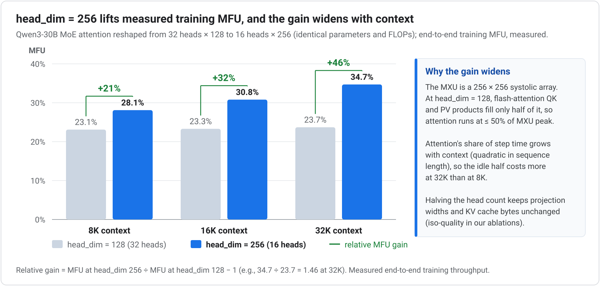
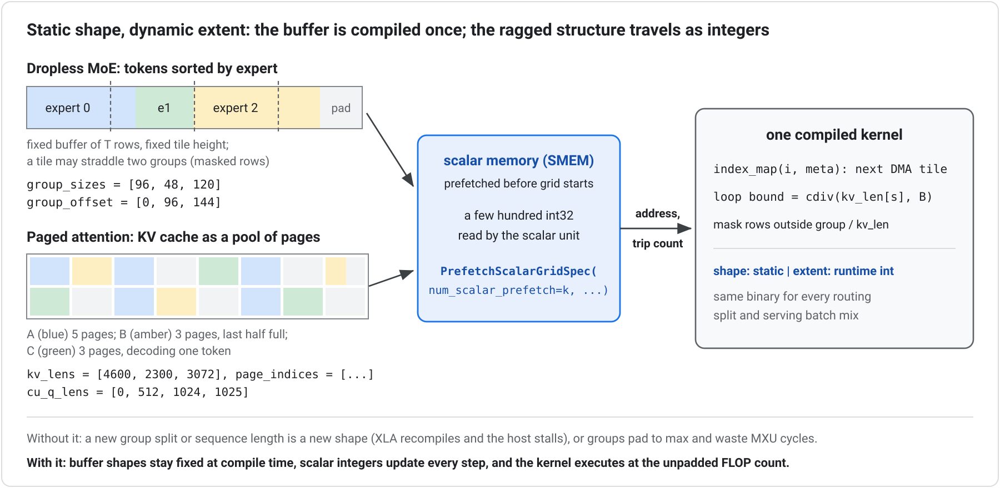

# Part I: Shape Rules (Adopt Always)

Shape rules align model tensor dimensions, batch divisibility, and runtime execution shapes with the TPU compiler and MXU datapath. They carry near-zero model-quality risk and belong in every new model definition before the first training run.

---

## 1. Align every per-device reduction and output dimension to 256

Make `d_model`, FFN and expert intermediate dimensions (`d_ff`), latent widths (`ℓ`), attention projection widths, and padded vocabulary sizes multiples of 256 **per device (TensorCore) after applying model sharding** (`d_ff / TP`, and `ℓ / TP` if sharded; tensor parallelism leaves `d_model` unsharded), matching the MXU's 256×256 systolic array (a 2,880-wide model, $11.25 \times 256$, pays a hardware padding tax that no kernel tuning can remove).

Strictly, systolic tile alignment binds a matmul's contracting (reduction) and output dimensions; token and batch axes stream freely through the array, and counts such as query/KV heads, layers, and experts are exempt so long as the underlying head and hidden widths are aligned. Because every model width listed above acts as a contracting or output axis in at least one forward or backward GEMM, aligning all of them to 256 avoids wasted cycles across the entire step.

The most frequently missed dimension is **`head_dim`**: at `head_dim = 128` or `64`, the $QK^\top$ and $PV$ products in FlashAttention leave the MXU ≥ 50% idle. Reshape to **`head_dim = 256`** with proportionally fewer Q and KV heads, preserving total projection widths, parameter count, FLOPs, and logical KV cache bytes. Coordinated-reshape ablations confirm iso-quality.

**Measured:** Reshaping Qwen3-30B MoE attention from 32 heads × 128 to 16 heads × 256 (identical parameters and FLOPs) accelerated end-to-end training on Ironwood, with the speedup widening at longer sequence lengths as quadratic attention takes a larger share of step time:

| Context length | `head_dim = 128` | `head_dim = 256` | End-to-end MFU gain |
| :--- | ---: | ---: | ---: |
| 8K | 23.1% MFU | **28.1% MFU** | +21% |
| 16K | 23.3% MFU | **30.8% MFU** | +32% |
| 32K | 23.7% MFU | **34.7% MFU** | **+46%** |

MXU-aligned grouped-matmul tiles added a further ~+15% speedup on the MoE expert GEMMs.

**Non-quadratic and linear attention:** These alignment rules apply to chunkwise linear and recurrent attention kernels as well. Notably, Gated DeltaNet ablations in [Yang et al. (2025)](https://arxiv.org/abs/2412.06464) report on-par or better model quality at `head_dim = 256` while matching wide systolic tiles.

**Precedent from GPU co-designed models:** NVIDIA revised [Nemotron 3](https://arxiv.org/abs/2512.20856)'s final dimensions so the hidden width entering all-to-all dispatch was divisible by 512 (a DeepEP requirement), and Microsoft's [MAI-Base-1](https://microsoft.ai/pdf/mai-thinking-1.pdf) ladder sets hidden size $D = L \times 256 / 3$ while rounding query heads up to multiples of 16 for tensor-parallel serving. See [Appendix A.1](appendix-a.md#a1-stay-in-the-conventional-aspect-ratio-band-explore-wider-not-deeper-within-it-via-ladder-ablations), [Appendix A.2](appendix-a.md#a2-one-knob-layer-count-scales-the-family-ratios-stay-tpu-friendly), and [Appendix A.5](appendix-a.md#a5-train-big-serve-small-as-a-planned-path) for aspect-ratio ladders and distilled student tiers.

---

## 2. Plan one parallelism strategy from 4 chips to multi-pod

Choose model dimensions and batch sizes so a single parallelism plan scales cleanly across every deployment tier: debuggable on 4 chips, high-MFU on a full ICI slice, and scalable across pods using **only DP, FSDP, or PP over DCN, never EP or TP** ([Principle 10](systems-mapping.md#10-map-model-axes-onto-the-physical-mesh) covers the physical link mapping). One direct constraint follows: the global batch size must divide evenly across the batch-sharding axes of every mesh configuration you plan to run.

Across DCN, both flavors of data parallelism work:

* **Plain DP** replicates weights across slices and synchronizes gradients once per optimizer step.
* **Multi-slice FSDP** shards weights across DCN as well, saving HBM at the cost of re-gathering weights over DCN.

Without gradient accumulation, DP and FSDP move comparable bytes over DCN and both can hide behind compute. **With gradient accumulation**, every microbatch repeats FSDP's weight re-gather over DCN while plain DP still synchronizes gradients only once per step. Default to plain DP over DCN (less network traffic, one easy-to-hide sync) and switch to DCN FSDP only when the model requires cross-slice HBM capacity; confirm either choice with a short profiled run. For the same reason, multi-slice FSDP combines poorly with pipeline parallelism (PP): PP executes many microbatches per step and each microbatch would repeat the DCN weight re-gather, so pair PP with plain DP whenever HBM allows.

**Measured:** Scaling across two slices with plain DP over DCN is near-free in practice, costing only **~1% of per-chip throughput**.

---

## 3. Static and Dynamic Shapes

XLA compiles each program for exact input tensor shapes and dtypes, so every buffer has a fixed address and every loop a known trip count; introducing a new shape at runtime triggers recompilation and a host stall. Dynamic workloads still fit this execution model cleanly: the key is to **separate the compile-time shape of a buffer from the runtime extent of the data inside it**.

* **Bucketing, masking, and packing:** At the program level, pad serving requests to a small set of precompiled sequence-length and batch-slot buckets (warmed up at server startup), replace data-dependent branches with attention or loss masks rather than shape-changing slices, and pack multiple training examples into fixed-length sequences with segment masking (`packing=True` in open-source [MaxText](https://github.com/AI-Hypercomputer/maxtext), enabled by default) so padding tokens never reach the MXU.
* **Scalar prefetch (`PrefetchScalarGridSpec` in `SMEM`):** Dynamic ragged structure arises every step in **dropless MoE layers**, which route a different number of tokens to each expert, and in **paged attention**, where every sequence has its own KV length, its own scattered set of cache pages, and in a mixed batch its own phase (prefill or decode).

Instead of padding every expert group to the largest group or every sequence to the maximum context length, keep the underlying HBM buffers at fixed shapes (tokens sorted by expert and padded only at the tail; the KV cache allocated as a fixed pool of pages) and describe the ragged layout with small `int32` metadata arrays (`group_sizes` and `group_offset` for MoE; `kv_lens`, `page_indices`, and `cu_q_lens` for paged attention). Pallas prefetches those integers into the TensorCore's scalar memory (`SMEM`) before the kernel grid starts via `PrefetchScalarGridSpec`, and the scalar unit reads them to compute the next DMA tile address and bound its inner loops, masking only tiles that straddle an expert boundary or a partially filled final page. Data dependence becomes a runtime address and trip count rather than a tensor shape, so one compiled binary serves every routing split and batch composition at the unpadded FLOP count.

* **Dropless MoE routing in practice (`Megablox` and Tokamax GMM):** Enable TPU ragged grouped-matmul kernels (`sparse_matmul=True` with Megablox by default in MaxText, or `use_tokamax_gmm=True` via open-source [Tokamax](https://github.com/openxla/tokamax) scalar-prefetch GMMs). Both dropless and capacity-factor routing preserve static outer buffer shapes; the difference is **model quality**. Capacity-factor routing drops overflow tokens when an expert exceeds its capacity budget, degrading loss and skewing MoE architecture ablations even at low drop rates ([MAI-Thinking-1](https://microsoft.ai/pdf/mai-thinking-1.pdf)), while still burning dense matmul FLOPs across padded capacity slots. Ragged-GMM kernels remove the speed penalty for dropless routing altogether. (The dense-dropless fallback `sparse_matmul=False` is strictly a correctness debugging baseline, not a performance path.)

**Frontier routing precedent:** Avoiding capacity-drop artifacts pushed the [MAI-Thinking-1](https://microsoft.ai/pdf/mai-thinking-1.pdf) team to fully dropless MoE training, which TPU ragged-GMM kernels support natively. [Kimi K3](https://arxiv.org/abs/2607.24653) co-designs the router itself around this property, using quantile-based expert balancing to achieve balanced expert-parallel training with static shapes and zero host synchronization on the critical path.
