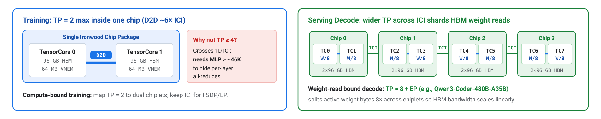
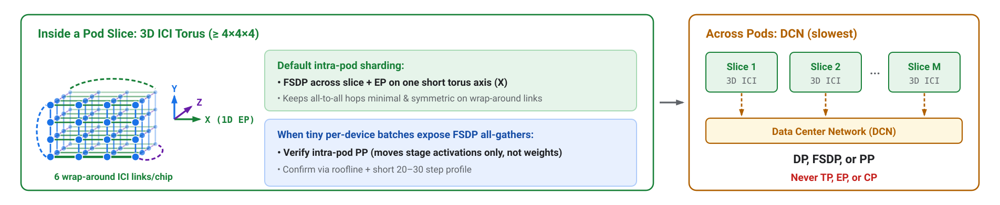
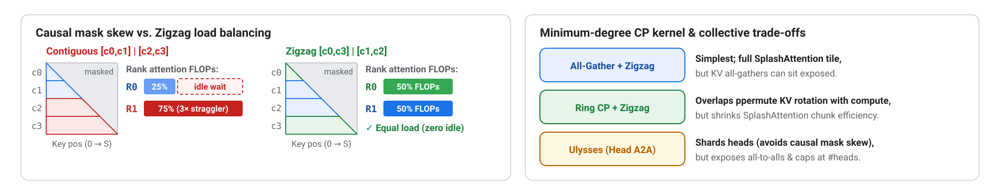
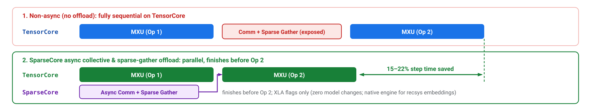

# Part III: Expressing Parallelism & Systems Mapping (No Model Changes Required)

Expressing parallelism and tuning the runtime stack apply equally when training a new architecture from scratch or adapting an existing open-weight checkpoint without modifying weights or numerics.

---

## 10. Map model axes onto the physical mesh

The rule that holds 99% of the time: **assign every logical parallelism axis to a physical network link, placing the most communication-intensive sharding on the fastest link** (`D2D → 3D ICI torus → DCN`, from fastest to slowest) while keeping logical mesh factors aligned with physical torus dimensions. Topology mismatches appear immediately in XProf traces as exposed communication stalls: inter-chip TP during training, EP or TP crossing DCN, or logical mesh dimensions that do not cleanly divide the physical torus axes.

Within that link hierarchy:

* **TP = 2 maximum for training (mapped to D2D), wider TP for decode:** On Ironwood, TP = 2 stays on the ~6× faster intra-package die-to-die (D2D) link between the two TensorCore chiplets. Extending TP to 4 across 1D ICI requires an MLP intermediate width above ~46K to clear the ~11,500 BF16 (~23,000 FP8) FLOPs/byte ICI threshold, which virtually no model reaches. **Serving decode is different:** decode is HBM-bandwidth-bound, so wider TP shards weight *reads* rather than hiding compute (for example, Ironwood vLLM recipes serve Qwen3-Coder-480B-A35B with TP = 8 plus EP).

* **FSDP as the training default; EP on one short torus axis; DP/PP over DCN:** Keep per-device batch tokens large enough that layer compute hides FSDP weight all-gathers. When tiny per-device batches expose FSDP weight all-gathers inside a pod, verify intra-pod PP (which moves only stage-boundary activations, not weights) or EP (paired with LatentMoE and FP8 dispatch, [Principle 4](architecture-choices.md#4-compress-routed-token-traffic-with-latentmoe)) via roofline arithmetic and a short 20–30 step profile.

* **Minimum-degree context parallelism (CP) matched to kernel trade-offs:** Choose among the three CP variants based on what each exposes:
    * **All-gather CP:** Simplest implementation and preserves full `SplashAttention` tile sizes, though its KV all-gathers can sit exposed; **requires zigzag/striped sequence load balancing** (`context_parallel_load_balance` in open-source [MaxText](https://github.com/AI-Hypercomputer/maxtext)) so causal masking does not leave tail ranks idle.
    * **Ring CP:** Overlaps `ppermute` KV rotation with attention compute, but still requires zigzag load balancing and sequence-packing support, and smaller per-step chunks can reduce `SplashAttention` tile efficiency.
    * **Ulysses all-to-all CP:** Shards attention heads so causal load imbalance disappears altogether, but exposes all-to-all collectives and is hard-capped by the head count.

* **Enable SparseCore async offload:** Offloading asynchronous collectives (all-gather, reduce-scatter, all-reduce, ragged all-to-all) and embedding-style sparse gathers onto SparseCore cuts training step time by **15–22%** in [tpu-recipes](https://github.com/AI-Hypercomputer/tpu-recipes) Ironwood benchmarks via XLA flags alone, with zero model changes (always confirm the win on your workload with a short profile; SparseCore is likewise the native execution engine for large recsys-style embedding tables).

---

## 11. Tune the memory pipeline

Use explicit [Pallas pipelining](https://docs.jax.dev/en/latest/pallas/tpu/pipelining.html) to overlap `HBM ↔ VMEM` DMA prefetching and double-buffering with MXU/VPU compute while keeping live tiles, intermediates, and scratch buffers inside the 64 MiB VMEM per TensorCore.

Two empirical knobs govern memory-pipeline efficiency on every new shape:

1. **Scoped VMEM budget (`xla_tpu_scoped_vmem_limit_kib`):** Controls how much of the 64 MiB VMEM custom kernels may claim as scratchpad space. Raising it toward the full `65536` KiB allows larger tiles and fewer HBM stalls, trading off headroom for compiler weight prefetching.
2. **Shape-dependent kernel block search (`tune-jax`):** Compiler default block sizes are conservative, and **optimal block shapes shift with model dimensions and sequence length**. Search block sizes empirically with [`tune-jax`](https://github.com/rdyro/tune-jax) whenever model shapes change. For reference, the DeepSeek-V3 Ironwood recipe in [tpu-recipes](https://github.com/AI-Hypercomputer/tpu-recipes) sets scoped VMEM to the full 65,536 KiB, `SplashAttention` block sizes to 2,048, custom rematerialization, and a two-stage all-gather for FSDP-sharded expert weights; mine published recipes as tuned starting points rather than treating them solely as launch scripts.

See [Appendix A.3](appendix-a.md#a3-remat-friendly-blocks) and [Part IV](blueprint-and-diagnostics.md#diagnosing-your-own-runs) for activation rematerialization and HBM budgeting rules.

---

## 12. Co-design for prefill/decode disaggregation, and align with the TPU serving stack

Prefill is typically **compute-bound** (governed by time to first token, TTFT), whereas low-concurrency decode is **HBM-bandwidth-bound** (governed by time per output token, TPOT). Because the two phases prefer different slice topologies, sharding strategies, and batch sizes, **disaggregating prefill and decode onto separate chip pools** lets each phase run at its own latency/throughput optimum ([DistServe](https://arxiv.org/abs/2401.09670), [Sarathi-Serve](https://arxiv.org/abs/2403.02310)).

Design models and serving configs around what the Ironwood serving stack (`vLLM` on TPU) already optimizes for:

* **FP8 KV cache and `block-size = 256`:** MXU 256-alignment reaches directly into paged-attention cache layouts ([TPU Ragged Paged Attention](https://arxiv.org/abs/2604.15464)).
* **Regime-matched serving parallelism:** Use TP = 2 across the dual-chiplet D2D pair for 20–32B dense or MoE models, TP = 8 + EP for ~400B MoEs, or **decoupled attention DP + expert EP** to shard large expert pools without duplicating KV heads across TP ranks (as demonstrated in the [Qwen3.5-397B on Ironwood playbook](https://developers.googleblog.com/systems-engineering-playbook-optimizing-qwen-35-397b-moe-on-ironwood-tpu7x/)).

See [Appendix B](appendix-b.md) for the complete inference hardware-software co-design checklist and serving budget equations.

---

## 13. Use multi-pass BF16 for high-precision-bound compute

For workloads dominated by BF16-sensitive matrix multiplications (most notably long-context quadratic attention where direct FP8 quantization can degrade convergence or accuracy), native single-pass BF16 leaves MXU capacity unused whenever hardware low-precision MXU throughput exceeds native BF16 throughput by more than the pass count. In those regimes, use the **multi-pass BF16 algorithm** to execute BF16-accurate matmuls via multiple passes over the higher-throughput lower-precision MXU pipeline without sacrificing numerical fidelity. On Ironwood (TPU v7x), the FP8-to-BF16 MXU ratio is 2:1, so two or more low-precision passes cannot beat native single-pass BF16.
