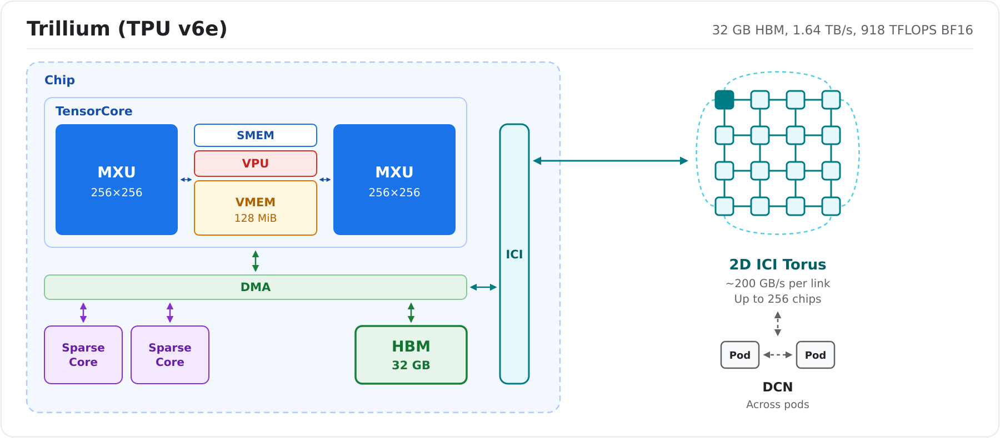

# Trillium (TPU v6e) Notes

The numbers in this guide are for Ironwood (TPU v7x). This page lists what stays the same on Trillium (TPU v6e) and what changes.

Trillium has the same 256×256 MXU as Ironwood, so the shape rules apply as written. Three hardware differences drive everything else:

1. **One TensorCore per chip.** There is no die-to-die (D2D) link, so each chip is one JAX device.
2. **One third of the HBM per device.** A Trillium chip has 32 GB, against 96 GB per Ironwood TensorCore.
3. **FP8 runs at the BF16 rate.** FP8 halves the bytes you move, but it does not make matmuls faster.

---

## Hardware at a glance

| Property | Trillium (TPU v6e) | Ironwood (TPU v7x) | Design consequence on Trillium |
| :--- | :--- | :--- | :--- |
| **MXU** | Two 256×256 arrays per TensorCore | 256×256 | Same rule: make every per-device contracting and output dimension a multiple of 256. |
| **TensorCores per chip** | 1 | 2, joined by a D2D link | One JAX device per chip. Any tensor parallelism crosses ICI. |
| **Peak BF16** | 918 TFLOPS/chip | 2,307 TFLOPS/chip | Divide by 918 when you compute MFU. |
| **Low-precision peak** | FP8 918 TFLOPS/chip (same as BF16); INT8 1,836 TOPS/chip | FP8 4,614 TFLOPS/chip (2× BF16) | Use FP8 to cut bytes, not matmul time. |
| **HBM per device** | 32 GB (31.25 GiB usable) @ 1,638 GB/s | 96 GB per TensorCore (192 GB @ 7.38 TB/s per chip) | Memory is the first limit. Budget HBM before anything else. |
| **Compute-bound threshold** | ≈ 560 BF16 FLOPs per byte read from HBM | ≈ 312 BF16 FLOPs per byte | Fewer ops stay compute-bound, so fusing elementwise work matters more. |
| **VMEM** | 128 MiB per TensorCore | 64 MiB per TensorCore | Kernels can hold larger tiles and more working state on chip. |
| **ICI** | 4 ports, 800 GB/s bidirectional per chip | 6 ports, 1,200 GB/s bidirectional per chip, plus the D2D link | Two torus axes instead of three. |
| **Topology** | 2D torus, up to 16×16 = 256 chips per Pod | 3D torus, up to 9,216 chips per Pod | Multi-slice training over DCN starts above 256 chips. |
| **DCN** | 4 × 200 Gbps NICs per 8-chip host (100 Gbps per chip) | 100 Gbps per chip | Same rule: only DP, FSDP, or PP across slices. |
| **SparseCore** | 2 per chip | 4 per chip | Async collective offload still applies. |

The compute-bound threshold is peak compute divided by HBM bandwidth (918 TFLOPS ÷ 1,638 GB/s).

!!! note "Sources"
    Trillium values come from the [Cloud TPU v6e documentation](https://cloud.google.com/tpu/docs/v6e), the generation comparison table in the [Cloud TPU7x documentation](https://cloud.google.com/tpu/docs/tpu7x), and the [Pallas TPU hardware reference](https://docs.jax.dev/en/latest/pallas/tpu/hardware.html). The wraparound rule for small slices is from [How to Scale Your Model](https://jax-ml.github.io/scaling-book/tpus/). The **Measured** results elsewhere in this guide were taken on Ironwood: expect the same direction on Trillium, not the same percentages.

---

## What carries over unchanged

These principles depend on the MXU width, static shapes, or routed-token volume, none of which change:

* **[Principle 1](shape-rules.md#1-align-every-per-device-reduction-and-output-dimension-to-256):** 256-aligned dimensions, including `head_dim = 256` (measured below).
* **[Principle 2](shape-rules.md#2-plan-one-parallelism-strategy-from-4-chips-to-multi-pod):** One parallelism plan from 4 chips to multi-pod.
* **[Principle 3](shape-rules.md#3-static-and-dynamic-shapes):** Static buffer shapes with dynamic runtime extent.
* **[Principles 4](architecture-choices.md#4-compress-routed-token-traffic-with-latentmoe) and [5](architecture-choices.md#5-raise-compute-intensity-with-a-large-shared-expert-and-wider-experts):** LatentMoE, a large shared expert, and wider experts. Checkpointing on the narrow latent also saves HBM, which matters more with 32 GB per device.
* **[Principle 7](architecture-choices.md#7-hybrid-attention-for-long-context-pick-the-tpu-mature-variant):** Hybrid attention for long context. Size KV cache and recurrent state against 31.25 GiB per device.
* **[Principle 9](architecture-choices.md#9-minimize-exposed-vpu-time):** Minimize exposed VPU time. The block-size threshold quoted there is an Ironwood number.

**Measured on Trillium (one attention layer, 8 chips):** Reshaping attention from 32 heads × 128 to 16 heads × 256, with 4 KV heads becoming 2 (same parameters, FLOPs, and KV bytes), made the layer's forward plus backward pass 1.60× to 1.71× faster:

| Sequence length | `head_dim = 128` | `head_dim = 256` | Speedup |
| :--- | ---: | ---: | ---: |
| 8K | 9.70 ms | 6.08 ms | **1.60×** |
| 16K | 30.68 ms | 18.53 ms | **1.66×** |
| 32K | 106.56 ms | 62.33 ms | **1.71×** |

Times are per device for one sequence in BF16 at `d_model = 2048` (4,096-wide query projection, 512-wide key and value projections), using `SplashAttention` with the fastest block size found for each shape. This is one attention layer in isolation: a full model gains less, because attention is only part of the step.

---

## What changes

| Principle | On Ironwood | On Trillium |
| :--- | :--- | :--- |
| **[6. Low precision](architecture-choices.md#6-low-precision-as-architecture-not-afterthought)** | FP8 doubles MXU throughput. | FP8 runs at the BF16 rate. Use it where bytes are the limit: KV cache, all-to-all dispatch payloads, and weight reads at decode. Benchmark block sizes on your own GEMM shapes. |
| **[8. Decode](architecture-choices.md#8-overcome-the-decode-bandwidth-wall-low-diameter-scale-out-81-and-speculative-decoding-82)** | About 300 concurrent tokens per FP8 weight shard reach the compute roofline. | About 280 tokens with FP8 weights and about 560 with BF16 weights (560 FLOPs per byte, at 2 FLOPs per parameter per token). Section 8.1 covers topologies Trillium does not have. Section 8.2 (speculative decoding) applies as written. |
| **[10. Map axes onto links](systems-mapping.md#10-map-model-axes-onto-the-physical-mesh)** | TP = 2 stays on the D2D link. | There is no D2D link, so any TP crosses ICI. For training, start with TP = 1 and use FSDP, plus EP for MoE. Keep EP on one short axis of the 2D torus. Above 256 chips, use DP (or FSDP or PP) across slices. |
| **[11. Memory pipeline](systems-mapping.md#11-tune-the-memory-pipeline)** | 64 MiB VMEM per TensorCore. | 128 MiB VMEM per TensorCore. Block sizes tuned on Ironwood may not be the best ones here: re-run the `tune-jax` search. |
| **[12. Serving](systems-mapping.md#12-co-design-for-prefilldecode-disaggregation-and-align-with-the-tpu-serving-stack)** | TP = 2 across the dual-chiplet pair for 20–32B models. | No dual-chiplet pair, so serving TP runs over ICI. The public Trillium vLLM recipes serve 32B models with TP = 4 on four chips and 70B models with TP = 8 on the single-host `v6e-8` slice. Plan weights plus KV cache per 32 GB chip. To cut KV bytes, use an FP8 KV cache (vLLM selects the `e5m2` format on Trillium). |
| **[13. Multi-pass BF16](systems-mapping.md#13-use-multi-pass-bf16-for-high-precision-bound-compute)** | No gain at a 2:1 FP8-to-BF16 ratio. | Does not apply: the ratio is 1:1. |
| **[Appendix A.3](appendix-a.md#a3-remat-friendly-blocks)** | Keep activations in HBM; host offload costs throughput. | HBM runs out sooner, so test host offload of layer inputs earlier (in MaxText, `remat_policy: custom` with `decoder_layer_input: offload`). Measure it against full rematerialization with a short profile. |
| **[Appendix A.8](appendix-a.md#a8-reference-performance-targets)** | Reference targets and MFU use 2,307 BF16 or 4,614 FP8 TFLOPS/chip. | MFU uses 918 TFLOPS/chip. |

By the arithmetic in Principle 10, a tensor-parallel collective over one ICI link stays hidden only above about 4,600 BF16 FLOPs per byte on Trillium (918 TFLOPS ÷ 200 GB/s). Each of the four ICI ports carries 200 GB/s (800 ÷ 4), the same per-link figure as Ironwood. Only a 16-chip axis has a wraparound link, so collectives take about twice as long on the shorter axes of smaller slices. For training, start from TP = 1, and add tensor parallelism only if your model clears that threshold and a short profile confirms it.

---

## Budget memory first

With 32 GB per device, check memory before you tune anything else:

1. **Fixed state.** Weights, gradients, and Adam moments take about 16 bytes per parameter, divided across the chips you shard over ([Part IV](blueprint-and-diagnostics.md#diagnosing-your-own-runs)). A 30B-parameter model needs about 480 GB: under 2 GB per chip on a full 256-chip Pod, but more than an 8-chip slice holds (8 × 31.25 GiB = 250 GiB usable).
2. **Activations.** They scale with per-device batch × sequence length. Expect a smaller per-device batch or more rematerialization than the same model uses on Ironwood.
3. **Architecture levers.** LatentMoE (checkpoint on the latent), windowed or linear attention (bounded KV or fixed-size state), and an FP8 KV cache all cut bytes per token.
4. **Systems levers, in order.** Shard weights further, apply selective rematerialization, reduce the per-device microbatch, then test host offload.

---

## Where to start

* Trillium training recipes (Llama 3.1 8B, 70B, and 405B, Gemma 3 12B on one, two, and four Pods, and Mistral 7B) are in [tpu-recipes](https://github.com/AI-Hypercomputer/tpu-recipes/tree/main/training/trillium).
* Trillium vLLM serving recipes (including Llama 3.x and Qwen3) are in [tpu-recipes](https://github.com/AI-Hypercomputer/tpu-recipes/tree/main/inference/trillium/vLLM).
* The diagnostic checks in [Part IV](blueprint-and-diagnostics.md#diagnosing-your-own-runs) apply unchanged. Compare large-GEMM throughput against 918 TFLOPS/chip.
